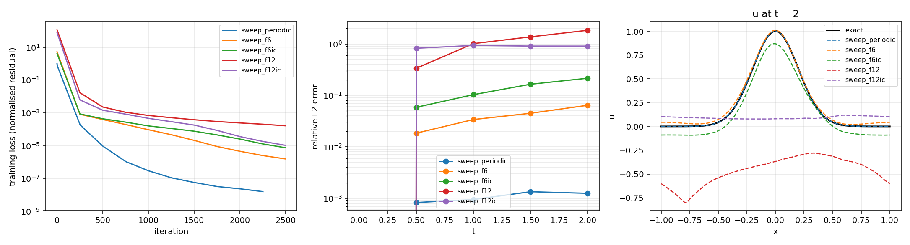
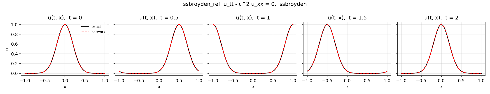
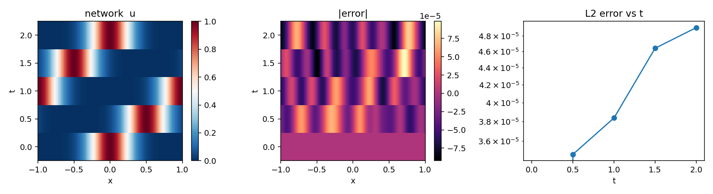
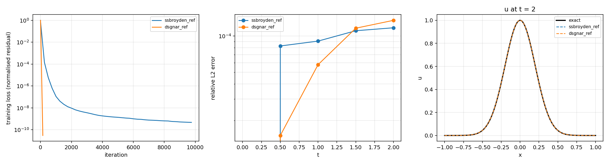
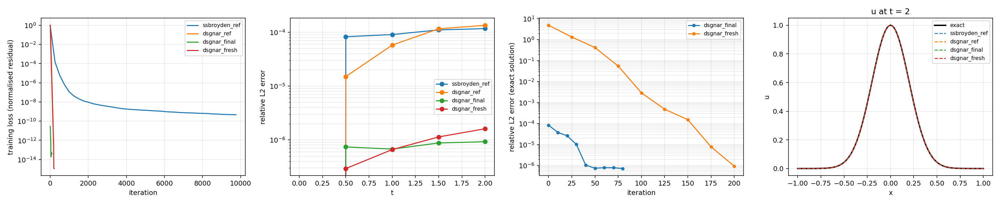
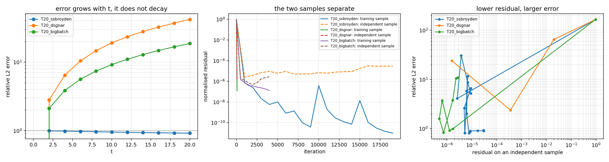

# Evolution_try — a PINN for the 1+1 wave equation, with SSBroyden and DSGNAR

A small, deliberately scheme-oriented JAX project for solving the second-order
wave equation in one spatial dimension with a physics-informed neural network,
plus a faithful port of the Gauss–Newton optimiser from the paper in `docs/`.

This directory is self-contained: everything it needs is here, including a
vendored copy of the `Crunch` SSBroyden implementation.

**The result, in one line.** Marching the problem in ten slabs of `dt = 2`, with each
window's initial data enforced as a penalty rather than built into the ansatz, and
DSGNAR at a sketch size of `0.68 d`, reaches a space-time relative `L2` of
**`6.3e-09`** at `T = 20`.  `d/2` is the measured cost/accuracy sweet spot; on that
same `soft_all` cell it gives `1.8e-06`, so the last step to `0.68 d` is worth another
288x on the chain even though it is worth only 6x on a single `T = 2` window. The four *global* solves tried first -- `t2` and `t2sat`,
SSBroyden and DSGNAR -- give 0.91, 3.48, 23.9 and 4.99. Eight to nine orders of
magnitude, and §6.9-6.11 say which of those decisions did the work, which did not,
and what is still wrong.

Two knobs matter and both were measured rather than inherited: the hand-over
(§6.9) and the sketch size (§6.10).  Two that the literature and a sibling project
suggested matter do **not** transfer here, and §6.9 records the retractions.

---

## 1. The problem

$$
u_{tt} - c^2 u_{xx} = 0, \qquad x \in [-L, L],\quad t \in [0, T],
$$

with `L = 1`, `c = 1`, `T = 2`, **periodic** boundary conditions in `x`, and
initial data

$$
u(0, x) = u_0(x), \qquad u_t(0, x) = v_0(x) = -c\,u_0'(x).
$$

The default initial profile is the Gaussian `u0(x) = exp(-x²/(2·0.2²))`. With
`v0 = -c u0'` the exact solution is the pure right-moving wave

$$
u(t, x) = u_0(x - ct),
$$

because the d'Alembert decomposition `u = F(x-ct) + G(x+ct)` with those two
initial conditions forces `G' = 0` and `F = u0`. With `c = 1` and `T = 2` the
pulse travels exactly one period, so `u(2, x) = u(0, x)`.

### The initial condition is hard-coded, not fitted

The network is

$$
\boxed{\;u_\theta(t, x) = u_0(x) + t\,v_0(x) + t^2\,N_\theta(\varphi(t,x))\;}
$$

so `u_θ(0, x) = u0(x)` and `∂_t u_θ(0, x) = v0(x)` hold **exactly, for every
parameter vector**. There is no initial-condition loss term anywhere in this
project, and no initial-condition weight to tune. The network only has to learn
the part of the solution that grows like `t²`.

### The boundary condition is hard-coded too

Periodicity is imposed by the *feature map*: the network input is

$$
\varphi(t, x) = \bigl(t/T,\ \cos(\pi x/L),\ \sin(\pi x/L)\bigr),
$$

i.e. the **plain network on the unit-amplitude sine/cosine pair**, with no
frequency expansion of any kind.  Every function built from those features is
`2L`-periodic, so `u(t, -L) = u(t, L)` for every parameter vector, and no
periodic penalty term is needed (one is available — `w_periodic` — but it could
only penalise the part of the ansatz the network cannot change).

One harmonic is enough, and adding more actively hurts.  The map
`x ↦ (cos(πx/L), sin(πx/L))` sends `[-L, L]` one-to-one onto the unit circle, so
a *nonlinear* network fed those two numbers can represent **any** `2L`-periodic
function of `x` — including the width-`0.2` pulse.  Extra harmonics add no
representational power; they add frequencies the optimiser has to fit, and §6.1
measures what that costs.

There is one wrinkle, handled in `wave_pinn/problem.py`: a Gaussian of width
`0.2` on `[-1, 1]` is *not* 2-periodic (it is `3.7e-6` at the ends, with a
non-zero slope there), and neither is `v0`.  The initial profile is therefore
replaced by its smooth periodic sum `u0_per(x) = Σ_n u0_raw(x + 2nL)`, which is
analytic and exactly periodic; on `[-1, 1]` it differs from the raw Gaussian by
less than `4e-6`.  Without that step the hard-coded part would break the
periodicity of the ansatz by about `2·10⁻⁴` at `t = 2`, and no amount of network
training could repair it.

---

## 2. What makes this problem hard

With this ansatz the exact remainder is

$$
N_{\text{exact}}(t,x) = \frac{u_0(x-ct) - u_0(x) + t\,u_0'(x)}{t^2}
   = u_0(x)\cdot\frac{e^{(xt - t^2/2)/\sigma^2} - 1 + xt/\sigma^2}{t^2},
$$

using `u0(x-t) = u0(x)·exp((xt - t²/2)/σ²)`. Two consequences shape every design
decision below:

1. **The hard-coded part is only a good approximation for small `t`.** It is the
   first two terms of the Taylor expansion of `u0(x-t)` in `t`, and at `t = 2`
   that expansion is worthless — the network has to cancel an `O(1)` smooth
   background to recover a pulse that has moved two units away.
2. **`N_exact` contains the narrow Gaussian at every order.** Its `x`-dependence
   is `u0(x)` times a *smooth* function, and the smooth factor is large (up to
   `e^{12.5}` on this domain) exactly where `u0` is small.  The network therefore
   has to represent a width-`0.2` feature, which is why §6.1 spends effort on
   what the input features let it see; the plain `(t, cos, sin)` map wins because
   a nonlinear network can build that feature from the two periodic coordinates,
   whereas a truncated Fourier series cannot.

---

## 3. Layout

```
Evolution_try/
├── README.md                     this file
├── docs/
│   ├── dsgnar_spec.md            page-cited specification of the paper (Algorithms 1-5,
│   │                             operators, hyperparameters, gotchas, reference code)
│   └── 2607.02194v1.pdf          the paper itself
├── wave_pinn/
│   ├── config.py                 every knob, one dataclass, JSON serialisable
│   ├── problem.py                u0, v0, the exact solution, the PDE residual
│   ├── features.py               the input feature maps (plain / fourier / *_ic)
│   ├── model.py                  the MLP and the hard-constrained ansatz
│   ├── sampling.py               collocation samplers and the residual normalisation
│   ├── losses.py                 the residual vector and the Objective wrapper
│   ├── optim/
│   │   ├── adam.py               Adam (warm-up or standalone)
│   │   ├── ssbroyden.py          Crunch's self-scaling Broyden, in blocks
│   │   ├── dsgnar.py             doubly-sketched Gauss-Newton with adaptive ratio
│   │   └── trustregion.py        exact-Hessian trust region (Xu & Darve)
│   ├── evaluate.py               error metrics and plots
│   ├── train.py                  the driver: build, optimise, measure, save
│   ├── compare.py                one table over every run in runs/
│   ├── plot_runs.py              loss curves and error-vs-t for several runs together
│   └── cli.py                    command line entry point
├── scripts/
│   ├── sweep_features.sh         the feature-map sweep
│   ├── run_reference.sh          the reference SSBroyden solve
│   ├── run_dsgnar.sh             the DSGNAR solve
│   ├── hessian_spectrum.py       measure the exact Hessian's eigenvalues
│   └── t20_diagnosis.py          the T = 20 figure: loss against error
├── tests/test_wave_pinn.py       unittest suite (no pytest needed)
├── vendor/Crunch/                vendored SSBroyden (from this repo's Jax/Crunch)
└── runs/<label>/                 one directory per run, see §5
```

Each run directory contains `config.json` (everything needed to reproduce it),
`theta.npy` (the flattened parameters), `history.json` (loss history, phase
information, error metrics), `fields.npz` (the fields on a test grid),
`report.md`, and three plots (`solution.png`, `error_map.png`, `loss.png`).

---

## 4. Running it

`Evolution_try` is self-contained.  It vendors the Crunch SSBroyden it needs under
`vendor/`, imports nothing from `Stationary/`, and writes **everything it
produces inside its own directory**:

```
Evolution_try/
├── runs/<label>/     one directory per run: config.json, history.json or
│                     windows.json, report.md, fields.npz, theta.npy, the figures
└── logs/             launcher logs and .pid files       (both gitignored)
```

You need an interpreter with `jax`, `numpy`, `scipy`, `optax` and `matplotlib`.
`scripts/env.sh` finds one for you, in this order: `$PY`, then
`Evolution_try/.venv`, then `~/jax_env` (the Mac development one), then
`../Stationary/.venv` (the CUDA one on the hub, a convenience, not a dependency),
then `~/venvs/pinn`, then `python3` on `PATH`.  To give the project its own venv:

```bash
cd <checkout>/Evolution_try
python3 -m venv .venv
.venv/bin/pip install "jax[cuda12]==0.11.1"     # or jax[cpu]; see requirements.txt
.venv/bin/pip install -r requirements.txt
.venv/bin/python -c "import jax; print(jax.version if hasattr(jax,'version') else jax.__version__, jax.devices())"
```

Then, from anywhere (the launcher resolves its own directory, so there is nothing
to `cd` to and nothing to export):

```bash
# check the environment: interpreter, devices, the private APIs, then the tests
bash <checkout>/Evolution_try/scripts/hub_run.sh --check

# the windowed T = 20 solve, detached, logging into Evolution_try/logs/
bash <checkout>/Evolution_try/scripts/hub_run.sh T20win_dsgnar dsgnar
bash <checkout>/Evolution_try/scripts/hub_run.sh T20win_ssbroyden ssbroyden
```

and from inside the directory, for the shorter things:

```bash
cd <checkout>/Evolution_try

bash scripts/run_reference.sh          # the reference SSBroyden solve
bash scripts/run_dsgnar.sh             # DSGNAR on the same problem
bash scripts/sweep_features.sh         # the feature-map sweep

# the DSGNAR sketch: measure before choosing s, then run the batch
$PY scripts/dsgnar_sketch_audit.py --k 4 --keys 6 --s 733 1100 1500 --skip-cold
bash scripts/run_sketch_curve.sh                      # T=2 to convergence, 3 sizes
DSGNAR_SKETCH=1100 FOCUSED=1 bash scripts/batch_runs.sh
$PY scripts/report_batch.py                           # BATCH_REPORT.md + the figure

PY=.venv/bin/python                    # or let env.sh find one; see above
$PY -m wave_pinn.cli --label my_try --set optimizer=adam+ssbroyden \
    --set features=periodic --set n_coll=4096
$PY -m wave_pinn.compare --out runs/COMPARISON.md
$PY -m wave_pinn.plot_runs --runs ssbroyden_ref dsgnar_ref --out runs/comparison.png
$PY -m unittest discover -s tests -v
```

`--set key=value` works for every field of `Config` (see `config.py`), values are
coerced to int/float/bool/JSON automatically, and `--config runs/<label>/config.json`
restarts from a previous run's configuration.  `--dry-run` prints the resolved
config without running anything.  Set `CRUNCH_ROOT` to use a different `Crunch`
checkout instead of the vendored copy.

**`s` is the knob to set first.**  The sketch size is worth three orders of
magnitude here (§6.10), and `s = d/3`, the package default and the bottom of the
paper's recommended range, is the wrong end of it.  `dsgnar_sketch=1100` (`d/2`) is
the measured sweet spot; `scripts/dsgnar_sketch_audit.py` costs ten minutes and needs
no GPU, so it is worth running before any long batch.

**Git hygiene.**  `runs/` is **gitignored and machine-local** -- it is produced where
the GPU is, and committing it from another machine makes the producing machine's next
`git pull` abort with *"untracked working tree files would be overwritten"*, which is
a dead end rather than a merge conflict.  The repository's record of results is the
derived `BATCH_REPORT.md` and `plots/`, which `scripts/report_batch.py` regenerates
from whatever `runs/` holds.  `logs/` is local in the same way.

**Surviving a disconnect.**  `scripts/hub_run.sh` and the batch scripts detach with
`setsid nohup`, which survives a browser disconnect and a Jupyter *server process*
restart.  It does **not** survive the single-user container being recreated (what
"stop/start server" often does), and a lost batch there leaves nothing running.  The
batch scripts are resumable, so the cure is to relaunch; but the signal to watch is
the **run's own** `logs/<label>.log`, which grows every 25 DSGNAR iterations --
`logs/batch.log` and the launcher's output only change at run boundaries and can be
silent for hours while everything is fine.


---

## 5. The schemes available

Every row is a config field; nothing here needs a code change to switch.

| Knob | Values | Meaning |
|---|---|---|
| `equation` | `wave2`, `advection` | `u_tt - c²u_xx = 0` or `u_t + c u_x = 0` |
| `ansatz` | `t2`, `t` | `u0 + t v0 + t²N` (both initial conditions) or `u0 + t N` |
| `features` | `periodic`, `periodic_ic`, `fourier`, `fourier_ic`, `plain`, `plain_ic` | `(t, cos, sin)` — the default; `fourier` adds harmonics `n = 1…K`; `*_ic` also feeds `u0`, `v0`; `plain` feeds a raw `x` (not periodic, diagnostics only) |
| `n_modes` | any integer | harmonics `K`, used only by `features="fourier"` |
| `sampler` | `uniform`, `random`, `grid_random`, `lhs` | collocation points |
| `n_coll` | any integer | collocation points; `0` (default) = one per trainable parameter |
| `windows` | int | number of time slabs; `1` (default) = one global solve on `[0, T]` |
| `ansatz` | `t2`, `t2sat`, `t` | `t^2`, `t^2/(tau^2+t^2)` (bounded) or `t` in front of the network |
| `residual_norm` | `auto`, `none` | divide the residual by its batch scale (a conditioning device) |
| `optimizer` | `adam`, `ssbroyden`, `adam+ssbroyden`, `dsgnar`, `adam+dsgnar`, `trustregion`, `adam+trustregion` | optimiser, or a warm-up followed by one |
| `tr_*` | see `config.py` | the trust-region Newton knobs: radius, eta, `tr_hessian` (`exact` or the `gauss_newton` ablation) |
| `n_layers`, `n_neurons` | any | architecture (default `6 × 20`, the requested one) |
| `activation` | `tanh`, `sin`, `gelu`, `relu`, `softplus` | |
| `init` | `glorot`, `lecun`, `siren`, `uniform`, `zeros` | |
| `periodize_ic` | bool | use the smooth periodic sum of `u0` (§1) |
| `w_periodic`, `w_l2` | floats | optional extra penalty terms (default off) |
| `resample_every`, `min_resamples` | int | redraw the collocation points every N steps, but at least `min_resamples` times per phase |
| `plateau_tol`, `plateau_patience` | floats/int | stop the quasi-Newton phase when it stops improving |
| `init_from` | path | warm start from a previous run's `theta.npy` (or its directory) |

### The optimisers

* **SSBroyden** (`ssbroyden`, the default). Optim.jl's self-scaling Broyden
  recurrence, as ported to JAX by `Crunch` (`update_method="ssbroyden2"`). The
  dense inverse Hessian is `n_parameters²` — 46 MB here — which is exactly why
  this project uses a 6 × 20 network. `Crunch` has no per-iteration callback, so
  the phase runs in blocks and carries `H` across block boundaries; the
  reasoning is documented at the top of `optim/ssbroyden.py`.
* **DSGNAR** (`dsgnar`). The paper's doubly-sketched Gauss–Newton with adaptive
  ratio: a *square* `s × s` sketch `J̃ = C J ΩS` (CountSketch on the rows, a
  subsampled orthonormal DCT on the columns), one SVD of it, and from that SVD a
  Levenberg–Marquardt step for every candidate trust-region radius at once; the
  radius whose measured decrease ratio is closest to a target `ϱ*` is chosen,
  and `ϱ*` steps up from `0.15` to `0.5` once the regularisation `λ` has bottomed
  out. `wave_pinn/optim/dsgnar.py` documents every place where the paper, its
  Algorithm boxes and the authors' reference code disagree, and which one was
  followed.
* **Adam** (`adam`, or as a warm-up in `adam+ssbroyden`). Included because PINN
  practice usually starts with it; it plateaus orders of magnitude above the
  quasi-Newton phases on this problem.
* **Trust-region Newton** (`trustregion`) — the optimiser of Xu & Darve,
  arXiv:2105.07552, and the third scheme this project was asked to carry.  It uses
  the **exact dense Hessian**, which is what makes it different from DSGNAR: the
  Gauss-Newton part `J^T J` plus `Σ_i r_i ∇²r_i`, and that second term is what
  makes the model indefinite.  See §6.7.
* **Broyden the root finder** (`jaxopt_broyden`, opt-in). `jaxopt`'s limited-memory
  rank-1 method for `r(θ) = 0` rather than for `min ‖r‖²`.  This is the only Broyden
  in the JAX ecosystem -- `jax.scipy.optimize.minimize` has one method, `BFGS`, and
  no Broyden -- and it is the right shape for a hard-constrained ansatz, where
  `r = 0` is achievable rather than a proxy.  It diverges here, and §6.12 shows that
  the cause is its backtracking line search rather than its step direction.
* **The Wolfe family** (`jaxopt_bfgs`, `jaxopt_lbfgs`, `jaxopt_ncg`, `optax_lbfgs`).
  Quasi-Newton methods on a strong-Wolfe zoom line search, which is what the
  Broyden would need and cannot have.  They progress smoothly and are still ten
  orders of magnitude behind DSGNAR to convergence; §6.12 has the numbers, and
  `optim/wolfe.py` is labelled a measured negative control rather than a contender.

### Stopping criteria

Each phase reports why it stopped in `info["stopped"]`, which is printed and
written into every run's `report.md`.  There is no single criterion, and it is
worth knowing which one actually fires.

**SSBroyden**, inside one `Crunch` call (a *block* of `qn_block` iterations):

| status | meaning |
|---|---|
| 0 | converged: `‖∇L‖∞ < qn_gtol` (default `1e-14`) |
| 1 | the block's iteration budget ran out — the normal case |
| 3 | the Wolfe line search's zoom failed, which is normal once the gradient is tiny |
| 5 | the line search hit its own iteration cap |

**SSBroyden**, across blocks (`optim/ssbroyden.py`):

| `stopped` | condition |
|---|---|
| `converged` | a block returned status 0 |
| `plateau` | relative gain per block ≤ `plateau_tol` for `plateau_patience` consecutive blocks |
| `no progress` | a block returned zero iterations and did not improve |
| `diverged` | non-finite loss |
| `budget` | `round(qn_steps / qn_block)` blocks were run |

**DSGNAR** (`optim/dsgnar.py`):

| `stopped` | condition |
|---|---|
| `radius below threshold` | trust-region radius `< 10 · dsgnar_delta_min` (default `1e-13`) |
| `budget` | `dsgnar_steps` iterations were run |
| `diverged` | non-finite loss |

With that on the record: **`runs/ssbroyden_ref` and `runs/dsgnar_ref` both stopped
on `budget`, not on convergence.**  SSBroyden had 9753 iterations (fewer than the
10000 asked for, because its first block returned after 3 with status 3) and was
still improving by ~3 % per block, forty orders of magnitude above its plateau
tolerance.  DSGNAR stopped at 150 iterations with a trust-region radius of
`1.36e-2`, eleven orders of magnitude above its own threshold.  Neither run was
finished; §6.5 runs both further.

### Collocation redraws

The residual is estimated on a finite sample, and a frozen sample is eventually
*fitted* rather than estimated.  `resample_every` (default 250 steps) turns on
redraws, and the interval between them grows geometrically
(`resample_growth`, default 1.5) from an early first redraw:

| phase | budget | first redraw | redraws scheduled |
|---|---|---|---|
| SSBroyden | 8000 | 200 | 10 |
| DSGNAR | 250 | 6 | 10 |
| DSGNAR | 150 | 4 | 10 |

**`resample_every` means what it says: a fixed period.**  Setting
`min_resamples > 0` instead asks for a *guaranteed number* of redraws inside the
phase, which front-loads them geometrically from `resample_span * budget /
growth^(min_resamples-1)`.  The two are separate because fusing them was a
mistake: with the guarantee on by default, `resample_every=250` on a 500-iteration
phase redrew at step 13, not 250 — not something a reader of the config could see.

`resample_span` (default 0.15) is where the assumption lives: it is the fraction
of the phase by which the guaranteed redraws must be complete, i.e. how early a
phase is assumed to stop.  It replaced a hard-coded `8` in the denominator, which
was `growth^4 = 5.06` with 1.6x of unexplained margin and quietly meant a span of
0.127.  A DSGNAR phase does stop on its own radius criterion well before budget,
which is why redraws have to be early or they never fire at all.

Each phase reports the count it actually performed in `info["resamples"]`.

**Correction, from the finished T = 20 runs.**  An earlier note here claimed that
redrawing costs six orders of magnitude in the loss — `1.05e-09` with nine redraws
against `4.48e-15` with none.  That comparison was confounded: the run with the
redraws was also the run whose time feature was divided by the global `T` instead
of the window width (the bug in section 6.9).  With that fixed, redraws make no
measurable difference at this phase length: the two finished windowed runs
performed 6-8 redraws per window and reached `1.5e-14` (hard hand-over, window 1,
245 iterations) and `7.8e-15` (soft, 238 iterations), against `2.37e-14` for a
standalone phase with no redraws at all.  Resampling was never the problem, and
mid-phase redrawing is not what a long phase needs protecting from.

Redrawing only works with a stochastic sampler; `sampler="uniform"` is a
deterministic tensor grid that ignores the key, so `validate()` rejects that
combination rather than silently redrawing the same points — which is exactly
what happened during development: the redraw messages printed, and the loss, the
points and the normalisation constant were all bit-identical before and after.

The sample size defaults to **one collocation point per trainable parameter**
(`n_coll=0` means "resolve to the parameter count").  Below that the residual is
under-determined and the sampled loss can be driven to zero while the solution
drifts; far above it each iteration costs more for little extra signal.

---

## 6. Results

Everything below is reproducible with the scripts in `scripts/`; the runs are
kept under `runs/`, each with its `config.json`, and the table in
`runs/COMPARISON.md` is regenerated by `python -m wave_pinn.compare`.

### 6.1 Which input feature map

Identical budget throughout: 2048 random collocation points, 2500 SSBroyden
iterations, `qn_block = 250`, seed 0.

| features | modes | final loss | rel `L2` (space-time) | rel `L2` at `t=2` | wall |
|---|---|---|---|---|---|
| **`periodic`** | 1 | **1.55e-08** | **9.96e-04** | **1.25e-03** | 425 s |
| `fourier` | 6 | 1.54e-06 | 3.90e-02 | 6.41e-02 | 294 s |
| `fourier_ic` | 6 | 7.40e-06 | 1.32e-01 | 2.15e-01 | 339 s |
| `fourier` | 12 | 1.62e-04 | 1.13 | 1.84 | 270 s |
| `fourier_ic` | 12 | 1.04e-05 | 8.00e-01 | 9.06e-01 | 337 s |



Read across: adding harmonics makes matters monotonically worse, which is the
opposite of the usual intuition, and the reason is in §1 — the harmonics do not
add representational power (the two periodic coordinates already span every
periodic function), they only add directions for the optimiser to get wrong.
Handing the network `u0` and `v0` as extra *inputs* (`*_ic`) also hurts here: the
profile is a sharp input, and the resulting residual landscape is harder to
descend than the one where the network has to build the pulse itself.

### 6.2 The reference SSBroyden solve

`runs/ssbroyden_ref` — the requested configuration, 4096 collocation points,
SSBroyden from a random initialisation, no Adam.

| | |
|---|---|
| parameters | 2201 (6 layers × 20 neurons, `tanh`, `d_in = 3`) |
| iterations | 9753 (39 blocks of 250) |
| final training loss | 4.70e-10 |
| **space-time relative `L2`** | **9.04e-05** |
| wall time | 71 min (single CPU) |

| `t` | rel `L2` | max abs. error |
|---|---|---|
| 0.0 | 0.0 (hard-coded) | 0.0 |
| 0.5 | 8.26e-05 | 6.80e-05 |
| 1.0 | 9.06e-05 | 7.23e-05 |
| 1.5 | 1.10e-04 | 9.85e-05 |
| 2.0 | 1.17e-04 | 8.58e-05 |




The `t = 0` error is exactly zero because the initial condition is hard-coded,
not fitted; the error that remains grows slowly with `t` and is a striped
`~10⁻⁵` pattern in space-time, i.e. the network's residual noise, not a visible
distortion of the pulse.

### 6.3 DSGNAR on the same problem

`runs/dsgnar_ref` — the paper's optimiser, 2048 collocation points, sketch rank
`s = 733 = floor(d_θ/3)`, 25 probes per iteration.

| | SSBroyden | DSGNAR |
|---|---|---|
| iterations | 9753 | **150** |
| wall time | 4279 s | **918 s** |
| final training loss | 4.70e-10 | **2.98e-11** |
| space-time relative `L2` | **9.04e-05** | 8.37e-05 |
| rel `L2` at `t = 2` | **1.17e-04** | 1.35e-04 |
| per-iteration cost | 0.44 s | 6.1 s |



DSGNAR needs 65× fewer iterations and about 4.7× less wall time to reach the
same error. Each of its iterations is ~14× more expensive, because it builds a
fresh sketched Jacobian by 733 batched Jacobian-vector products and then
evaluates 25 trust-region probes in the full space, against SSBroyden's single
gradient per iteration.

Two things are worth recording from the log. First, the measured decrease ratio
sits at `0.146–0.158` for the whole run, i.e. on the stage-1 target `0.15` it was
asked for — the ratio machinery is calibrated, not merely non-diverging. Second,
every step was accepted and the stage-2 switch never fired, because the
regularisation `λ` fell to `~10⁻⁹` and then stopped climbing (the run hit its
150-iteration budget with the radius still shrinking). Both are visible in
`runs/dsgnar_ref/history.json`.

### 6.4 What the two optimisers cost here

The quasi-Newton inverse Hessian is `n_parameters²`; at 2201 parameters that is
39 MB, which is affordable only because the network is small — this is the same
trade that makes the 6 × 20 architecture the right one for the comparison. If
the network were widened, DSGNAR would still run (its cost grows with the sketch
rank `s`, not with `n`), while SSBroyden would not.

### 6.5 Running both further

Both §6.2 and §6.3 stopped on their iteration budget, so the obvious next
question is whether more iterations buy accuracy.  The answer is **no for
SSBroyden and a further 115× for DSGNAR**, and the difference is visible in the
independent-sample residual.

| run | optimiser | points | redraws | iterations | stopped | final loss | rel `L2` | rel `L2` at `t=2` | wall |
|---|---|---|---|---|---|---|---|---|---|
| `ssbroyden_ref` | SSBroyden | 4096 frozen | 0 | 9753 | budget | 4.70e-10 | 9.04e-05 | 1.17e-04 | 4279 s |
| `ssbroyden_cont` | SSBroyden | 8192 frozen | 0 | 3000 | budget | 3.96e-10 | 7.81e-05 | 1.12e-04 | 671 s |
| `ssbroyden_resample` | SSBroyden | 2201 | 10 | 8000 | budget | 3.75e-10 | 2.27e-04 | 4.05e-04 | 1360 s |
| `dsgnar_ref` | DSGNAR | 2048 frozen | 0 | 150 | budget | 2.98e-11 | 8.37e-05 | 1.35e-04 | 918 s |
| **`dsgnar_final`** | DSGNAR | 2201 | 7 | 86 | radius below threshold | 3.50e-14 | **7.25e-07** | **9.25e-07** | 645 s |
| `dsgnar_fresh` | DSGNAR | 2201 | 8 | 206 | radius below threshold | **1.14e-15** | 9.38e-07 | 1.61e-06 | 1964 s |



**SSBroyden is finished.**  Three attempts — 3000 more iterations on a larger
frozen sample, and 8000 iterations with the points redrawn — moved the error from
9.0e-05 to 7.8e-05 and then to 2.3e-04.  The third panel of the figure is the
diagnosis: with redraws, SSBroyden's error *oscillates* between 0.9 and 2.5e-04
while its independent-sample residual sits flat at ~6e-10 for the whole run.  It
is not converging further; it is random-walking on sampling noise around a
residual floor of a few times `10^-10`.  The redraws also cost accuracy relative
to the frozen 4096-point run, which is why the resampled run is the worse of the
two: at this residual level the sample-to-sample variation of the loss is larger
than the improvement per block.

**DSGNAR is not.**  Restarted from its own 150-iteration checkpoint with a
trust-region radius of `0.05` and the points redrawn 7 times, it drove the
residual from 2.9e-11 to 3.5e-14 and the error from 8.4e-05 to **7.2e-07** in 86
iterations, then stopped because its trust region collapsed below
`10·dsgnar_delta_min` — a real convergence criterion rather than a budget.  The
train and independent-sample losses agree to a few per cent at every probe
(`3.50e-14` vs `3.37e-14` at the end), so this is a genuine solution and not a
sample being fitted.  An earlier, independently scheduled run of the same
continuation reached `2.07e-06`, so the result is reproducible to about a factor
of three.

**From a random initialisation it is the same story.**  `dsgnar_fresh` starts
from the glorot initialisation (not from a checkpoint), with `Δ₀ = 1`, and needs
206 iterations to reach a residual of `1.1e-15` and an error of `9.4e-07` — no
warm start, no Adam, no hand-holding, and it still stops because the trust region
collapsed rather than because the budget ran out.  The right-hand panel of the
figure is its error against iteration: a straight line through eight orders of
magnitude.  The train and independent-sample losses agree at every probe
(`1.14e-15` against `2.58e-15` at the end), and the eight collocation redraws are
what make that agreement meaningful.

The consequence for the architecture is the interesting part: the `~10^-4` floor
that SSBroyden sits on is **not** a representational limit of the 6 × 20 network.
The same 2201 parameters represent the exact solution to `7·10^-7`; SSBroyden
simply cannot find it, which is precisely the ill-conditioning argument the paper
makes.

### 6.6 T = 20: where the loss stops predicting the error

The same two optimisers, run to `T = 20` (ten periods) on the same `[-1, 1]`
domain, with the tolerances opened right up: `qn_gtol = 1e-16`,
`plateau_tol = 1e-12`, `dsgnar_delta_min = 1e-15`.

| run | optimiser | points | iterations | stopped | final loss | rel `L2` | rel `L2` at `t=20` |
|---|---|---|---|---|---|---|---|
| `T20_ssbroyden` | SSBroyden | 2201 | 19763 | budget | **6.98e-12** | 9.07e-01 | 9.17e-01 |
| `T20_dsgnar` | DSGNAR | 2201 | 97 | radius below threshold | 1.67e-06 | 2.39e+01 | 4.20e+01 |
| `T20_bigbatch` | SSBroyden | 8192 | 4000 | budget | 1.30e-07 | 1.10e+01 | 1.87e+01 |



**Both fail, and driving the loss down makes it worse.**  SSBroyden reaches a
training residual of `7·10^-12` — three orders of magnitude better than its `T = 2`
result — with a 91 % error.  DSGNAR's error *grows* from 2.4 at iteration 50 to
23.9 at iteration 75 while its loss falls from `3.6·10^-4` to `1.7·10^-6`.

The middle panel is the mechanism.  The solid curves are the residual on the
collocation points the optimiser is looking at; the dashed curves are the residual
on an independent sample of the same size.  For SSBroyden the two end up a factor
of `3·10^6` apart (`9.6·10^-12` against `3.0·10^-5` at iteration 19013) — the
network is *interpolating the sample*, not solving the equation.  The right panel
is the consequence: across these runs the true error is anti-correlated with the
residual.

Two things are going on, and it is worth separating them:

1. **`n_coll = n_parameters` makes the sampled problem square.** Two thousand two
   hundred and one residual equations for two thousand two hundred and one
   parameters is generically *exactly solvable* whether or not the underlying PDE
   has been solved, so the loss can be driven to zero by interpolation.  At
   `T = 2` the interpolant happens to sit near the true solution; at `T = 20` it
   does not.
2. **The ansatz amplifies the error by `t²`.** The hard-coded part is
   `u0 + t·v0`, whose magnitude reaches 61 at `t = 20`, and the network must cancel
   it with `t² N`.  To hold the solution to `10^-3` the network must therefore
   represent `N` to about `10^-3/400 ≈ 2.5·10^-6` — and `N_exact` is a narrow
   feature that the `(t, cos, sin)` features have to build from scratch.

Over-determination was tried and did not rescue it: `T20_bigbatch` uses 8192 points
(3.7x the parameter count) and still ends at an 11x error, so (2) is the binding
constraint, not (1).

This is the same conclusion the DSGNAR paper's own trainer reaches for
time-dependent problems, and it is why it marches in slabs along the time axis,
restarting each slab from the previous one so that the hard part only grows by one
small `Δt`.  **A single global solve on `[0, 20]` with this hard-constrained ansatz
is the wrong formulation**, and the fix is time marching, not a better optimiser —
`T = 2` is well inside the regime where the one-shot ansatz works, and the errors
in §6.5 are real.

### 6.7 The third optimiser: exact-Hessian trust region

`wave_pinn/optim/trustregion.py` implements the optimiser of Xu & Darve,
*Trust Region Method for Coupled Systems of PDE Solvers and Deep Neural Networks*
(arXiv:2105.07552).  Two findings from reading it shaped the port, and both are
recorded in the module docstring:

* **The paper's optimiser is SciPy's.**  It specifies no trust-region loop; it says
  it uses Conn-Gould-Toint Chapter 7 "implemented in the scipy library", and the
  authors' own call site is
  `minimize(..., method="trust-exact", jac=..., hess=..., options={"maxiter":5000, "gtol":0.0})`.
  So the subproblem is More-Sorensen *nearly exact*: safeguarded Newton on the
  secular equation, a Cholesky of `B + λI` per trial `λ`, and a two-dimensional
  fallback along the negative-curvature direction in the hard case.  No CG, no
  dogleg, no Cauchy point, no preconditioner.
* **Hessian-vector products are not enough.**  The paper rejects matrix-free
  explicitly and SciPy requires a dense `(n, n)` array.  The subproblem solver is
  therefore delegated to `scipy.optimize._trustregion_exact.IterativeSubproblem`,
  after a hand transcription of it was written and *disagreed with the original on
  7 % of random indefinite problems* — the state that is easy to miss is that the
  hard-case quadratic term is taken with the shifted matrix `H + λI`, not `H`.
  Depending on the reference implementation is better than shipping an
  approximation of it.

The outer loop is ours, and is verified to reproduce SciPy's own trust-region loop
step for step (`test_outer_loop_matches_scipy_trust_exact`), which is the strongest
available statement since that loop *is* the paper's algorithm.

**The paper's premise holds for this problem.**  At the random initialisation with
`T = 2` and 2201 collocation points, the exact Hessian of the loss has

| | |
|---|---|
| `λ_min`, `λ_max` | `-1.906`, `+2.179` |
| negative eigenvalues | **766 of 2201** (34.8 %) |
| numerically zero (`|λ| < 10^-6 λ_max`) | 665 (30.2 %) |
| positive | 770 (35.0 %) |
| time to form the matrix | 108 s (uncontended; `runs/hessian_spectrum.json`) |

so the curvature really is indefinite, and the Gauss-Newton matrix DSGNAR uses
(which is positive semi-definite by construction) is not the whole story — which is
exactly why BFGS-method-style updates, which force positive definiteness, stall at
`10^-4` on this problem while DSGNAR does not.  `scripts/hessian_spectrum.py`
reproduces the measurement (and chunking the forward-over-reverse matters: the
unchunked `jax.hessian` at `n = 2201` is killed by the OOM killer).

**As a solver it is not competitive at this size.**  The `T = 2` run
(`runs/T2_tr`, 512 collocation points to keep the Hessian affordable, 40 iterations,
30 Hessians, 1825 s) reached a loss of `1.8·10^-3` and an error of 0.93 — nowhere
near converged, and ~10x more wall time per iteration than DSGNAR, whose Hessian is
never formed.  The paper's own networks are 901-921 parameters and needed ~270
iterations; at 2201 parameters the `n³` factorisation and the `n`
forward-over-reverse passes both grow, and the method's value here is the
diagnostic in the table above rather than the solution it produces.


### 6.8 Two attempts to make T = 20 work by staying global

**A saturating weight.**  The `t^2` in front of the network is what amplifies the
error at large `t`, so `ansatz="t2sat"` replaces it with `t^2/(tau^2 + t^2)`, which
is bounded by 1 and still satisfies `f(0) = f'(0) = 0`, so the hard-coded initial
condition survives untouched.  The parameter sensitivity is then flat in time --
measured, `max_theta |du/dtheta|` grows by a factor 6.4 from `t = 1` to `t = 20`
with `t^2` and by 1.0 with `t2sat`.

It does what it was meant to do, and it is not enough:

| run | ansatz | final loss | train vs independent residual | rel `L2` |
|---|---|---|---|---|
| `T20_ssbroyden` | `t2` | 6.98e-12 | `9.6e-12` vs `3.0e-05` (**3e6 apart**) | 0.907 |
| `T20sat_ssbroyden` | `t2sat` | 1.51e-07 | `1.7e-07` vs `2.2e-06` (13 apart) | 3.475 |
| `T20_dsgnar` | `t2` | 1.67e-06 | `1.2e-07` vs `1.6e-06` | 23.86 |
| `T20sat_dsgnar` | `t2sat` | 5.94e-06 | `5.9e-06` vs `1.6e-06` (2.6 apart) | 4.99 |

All four are failures with `O(1)`-to-`O(25)` errors, so the saturating weight is
*not* a fix on its own -- it changes which failure you get, not whether you get
one.  It buys the honest residual (below), and DSGNAR improves from 23.9 to 5.0,
while SSBroyden's error goes from 0.91 to 3.47 simply because its loss is then
three orders less converged.

`t2sat` **removes the sample-fitting**: the residual on the training sample and on
an independent sample now track each other to within an order of magnitude, where
with `t^2` they separated by six orders.  That is the conditioning diagnosis in
§6.6 confirmed -- but the residual it can actually reach stalls at `1.5e-07`, far
above what a `10^-4` error needs.  The pathology is gone; the accuracy is not
there.

**Windows.**  `windows=N` (and `wave_pinn/windows.py`) marches along the time axis.
Window `k` is solved with the ansatz built from the *previous window's own
solution*,

    u(t, x) = U_k(x) + (t - t_k) V_k(x) + f(t - t_k) N_theta(t - t_k, x),
    U_k = u_{k-1}(t_k),  V_k = d_t u_{k-1}(t_k),     both frozen,

so the hard part only has to cancel `dt * V_k`, and the network sees the local
time.  `u` and `u_t` are continuous across the edges by construction (tested to
1e-12), the second derivative is not, and each window reuses the same optimiser
code unchanged.

The machinery is verified but the T = 20 production run is a *long* one, and it is
worth recording why.  A window of width `dt` is exactly as hard as a `T = dt`
problem, and §6.5 measured what that costs: DSGNAR needs ~200 iterations and
SSBroyden ~10 000 to take `T = 2` down to `1e-6`.  Ten windows of `dt = 2`
therefore cost ~2000 DSGNAR iterations (about 4.5 h here) or ~100 000 SSBroyden
iterations (about 7 h) -- the same work as the global solve, redistributed.  An
under-trained window chain is worse than the global solve, and measurement bears
that out: with only 1000 SSBroyden iterations per window the chain's error grows
along it (1.2e-02 in window 1, 0.50 in window 3, 1.23 in window 4), because each
hand-over inherits the previous window's error.

So the recommendation stands, with a price tag attached: **window the problem, and
use DSGNAR inside the windows**, because it is the only one of the three that
reaches `1e-6` on a `T = 2`-sized problem in a couple of hundred iterations.

That was the state of things when this section was written, and it took two more
decisions -- neither of them in this section -- to turn "the natural next step" into
a result eight orders of magnitude better than everything above.  They are next.

### 6.9 The third attempt works: slab marching plus a soft hand-over

Two things had to change, and they turned out to be the two that matter.

**The hand-over has to be a penalty, not a constraint.**  Writing a window's ansatz
*relative to* the previous window's solution puts that solution's error inside the
ansatz, where the window's own residual cannot see it: the window then minimises the
loss subject to an initial condition that is already wrong, and the error is carried
forward however well it solves its own problem.  `window_ic="soft"` makes the
hand-over two penalty rows per edge point instead, pulling `u` and `u_t` onto the
values the previous window left at the shared edge.  The network can then trade an
initial-condition mismatch against the residual -- so it can *correct* what it
inherited rather than propagate it.  Measured, that is the difference between an
amplification of `x3-4` per hand-over (`hard`) and `x1.3-1.8` (`soft`), and it is
worth two to three orders of magnitude at `T = 20`.

**The time feature has to be scaled to the window, not to `T`.**  The network's time
input is `t / t_scale`.  With `t_scale = T = 20` and a window of width 2, every
window had to fit its whole evolution into `[0, 0.1]` of the input coordinate, at
ten times the effective frequency; window 1 came out at `2.9e-04` where the identical
`T = 2` problem gives `5e-06`.  `t_scale` is the window width now.  That bug was
worth 300x on the first window alone and is the reason an earlier windowed attempt
looked like it was degrading without limit.

**What it gives.**  Twenty windowed `T = 20` runs, ten windows of `dt = 2`,
float64 throughout, in `BATCH_REPORT.md` and `plots/batch_report.png`.  The
space-time relative `L2` of `dsgnar` at `n_coll = 8192`:

| hand-over | `s = d/3` (733) | `s = d/2` (1100) | `s = 0.68 d` (1500) | gain |
|---|---|---|---|---|
| `hard` | 1.877e-03 | 1.958e-05 | 2.674e-06 | 700x |
| `soft` | 9.980e-06 | 7.110e-07 | 1.642e-08 | 608x |
| **`soft_all`** | 2.861e-06 | 1.829e-06 | **6.344e-09** | 451x |

and at `n_coll = 2201`, `soft_all` improves from `7.834e-06` (`d/3`) to
`2.399e-07` (`0.68 d`).  SSBroyden, for comparison, sits at `8.4e-03` in its best
cell -- about 2900x worse than `dsgnar` at the same settings, for a tenth of the
time.

The best run this project has produced is therefore **`6.3e-09`** against the four
*global* `T = 20` solves at 0.91, 3.48, 23.9 and 4.99 -- eight to nine orders of
magnitude, from marching in ten slabs and letting each window's initial data be a
penalty rather than a constraint.  Aggregated over the ten windows, the error along
the chain stays between `1e-08` and `4e-08` instead of climbing to `10^-2`.

`window_ic="soft_all"` goes one step further and softens the *first* window too,
where the initial condition is the physical one rather than a hand-over.  That was
worth trying because the first window seeds every error that follows, and it is the
best column of the table -- but it is a genuine change to the problem statement:
`u(0,x) = u0(x)` is then satisfied to the penalty's accuracy rather than exactly, so
`hard` and `soft` remain the honest configurations and `soft_all` is an experiment.

### 6.10 The sketch size dominates every other knob here

`docs/dsgnar_spec.md` reproduces the paper's recommendation of `s` between a third
and a half of the parameter count, and asks that `s` "comfortably exceed the
numerical rank of `J`".  For this problem the second sentence is the operative one
and the first is not satisfied:

```
exact J at T = 2, n_coll = 2201, from scripts/dsgnar_sketch_audit.py
  singular values     6.997e+02 down to 4.557e-18, ratio 1.5e20
  numerical rank      619 at 1e-8 of the largest
                      914 at 1e-10
                     1233 at 1e-12        against s = 733 = d/3
  cosine between the lifted DSGNAR step and the exact Gauss-Newton step
    s =  733 (d/3)   0.42      s = 1100 (d/2)  0.62      s = 1500 (0.68 d)  0.75
```

`d/3` is below the numerical rank, so the column sketch truncates real curvature
directions and the lifted step is less than half aligned with Gauss-Newton.  The
audit costs about ten minutes and needs no GPU: `J` is 38.7 MB here, and
`jvp_columns` produces all 2201 columns in under a second.

That is not cosmetic.  `scripts/run_sketch_curve.sh` measures the other end of it,
`T = 2` to convergence on the A30:

| s | s/d | final loss | rel `L2` | wall |
|---|---|---|---|---|
| 733 | 33% | 2.283e-14 | 4.580e-06 | 144 s |
| 1100 | 49% | 2.897e-20 | 4.167e-09 | 215 s |
| 1500 | 68% | 5.412e-23 | 6.963e-10 | 276 s |

`d/3 -> d/2` costs 1.49x the time and buys **1099x**; `d/2 -> 0.68 d` costs another
1.28x and buys 6x.  So the paper's range spans three orders of magnitude on this
problem, the bottom of it is the wrong end, and **`d/2` is where the money is** --
past it the per-window solve stops being what limits the answer, because the
hand-over amplification takes over.

The practical consequence for anything already reported: the twelve-cell batch in
§6.5-6.8 was run at `s = d/3`, so its *absolute* DSGNAR numbers are far from what
the method does here.  Its *comparisons* -- `soft_all` over `soft` over `hard`, more
points over fewer, DSGNAR over SSBroyden -- are between runs sharing the handicap
and stand.

**Three retractions, recorded because two of them were asserted here first.**

* *"Redrawing the collocation points costs six orders of magnitude in the loss."*
  Wrong: the comparison (`1.05e-09` with nine redraws against `4.48e-15` with none)
  was confounded, because the run with the redraws was also the run whose time
  feature was divided by the global `T` instead of the window width -- the bug in
  §6.9.  With that fixed, redraws make no measurable difference at these phase
  lengths: 6-8 redraws per window still reached `1.5e-14` and `7.8e-15`.  §5.3
  carries the correction.
* *"`K = 4` is what made every stall."*  That is the sibling project's measurement,
  on its problem at `s = 128`, where the sketched model over-predicts the decrease
  by a factor 12.  It does not transfer: here the over-prediction is 1.0-3.3, `K = 4`
  and `K = 8` give the same step alignment (`0.315` against `0.303`), and the T=2
  accuracy is indistinguishable.  `K` is exposed and defaults to the paper's 4.
* *"Calibrating the predicted decrease will fix the convergence."*  Also theirs, and
  also not transferable: with nothing to correct, dividing by a noisy near-unity
  factor mostly adds variance to the radius choice -- it helped in some
  configurations and hurt in others, and in the warm-start test it was the only
  configuration that stopped early.  Implemented, tested, **off by default**, with
  the whole measurement table beside the knob in `config.py`.

The general lesson is in §8, and it is the one worth carrying elsewhere: a fix
measured on one problem at one sketch size is a hypothesis about another, not a
result.

### 6.11 The remaining defect: the stall

One failure mode is still not understood and is not rare.  A window's DSGNAR phase
can walk its trust region down to `delta_min` **while the loss is orders of
magnitude above the floor this same configuration reaches in other windows** --
measured, window 7 of `dsgnar_soft_nc2201` stopping at `7.6e-07` against a best of
`1.9e-15`, and one earlier attempt hung outright there with `rho = -4.9e13`.  Panel
(f) of the report counts the windows that had to be redrawn and re-run: **11 to 15**
in the hard runs, present in most others.  `window_retries` (default 2) catches it
by redrawing the collocation points and restarting from a fresh initialisation, and
keeps the better of the attempts; that rescued a cell from `3.719e-02` to
`2.505e-05` in one re-run.

What is established: it is not the stop rule (stopping on `radius below threshold`
after converging to `2.2e-14` is correct behaviour), it is not the hash count (K = 4
and K = 8 give the same step alignment), it is not the prediction (the sketched model
decrease is honest to within 13%), and it is not fixed by the sketch size -- the two
best runs each stalled once or twice and recovered.  What is not established is the
trigger.  `scripts/dsgnar_sketch_audit.py` is the instrument for it, pointed at a
*stalling* state rather than a converged one, which is the next experiment.

One cell in twenty is stall-*broken* rather than stall-limited:
`dsgnar_soft_all_nc2201_s1100` at `1.174e-02`, where window 9 stalled and the single
retry did not rescue it.  Read that row as an artifact.


### 6.12 The Wolfe family, and what the Broyden's failure actually was

The Broyden negative control (`optim/jaxopt_broyden.py`) diverged by nine orders of
magnitude, and
the natural reading was that its step direction is useless.  That reading was wrong,
and finding out why was worth the afternoon.

`jaxopt.Broyden` uses `linesearch="backtracking"` -- *"for now only backtracking"*,
its own docstring.  Backtracking shrinks by `decrease_factor` at most `maxls` times:
`0.8^15 = 0.035` by default.  The Broyden's first step is `-r`, and here `|r| = 48`
against `|theta| = 10`, so it has to shrink by far more than a factor of 28.  Every
Broyden configuration tried either exploded or stood still because the line search
could not shrink enough -- not because the direction had nothing in it.

A **strong-Wolfe zoom** search brackets and bisects and has no such floor.
`jaxopt.BFGS`, `LBFGS` and `NonlinearCG` all default to `linesearch="zoom"`, and
`optax.lbfgs` takes `optax.scale_by_zoom_linesearch`.  Measured, `T = 2`,
`n_coll = 2201`, 60 iterations, from a random start (`1.068e+00`) and from 1000 Adam
steps (`2.408e-03`):

| method | from init | from Adam |
|---|---|---|
| `jaxopt.BFGS` (zoom) | **1.685e-03** | **7.233e-04** |
| `jaxopt.LBFGS` (zoom) | 4.696e-03 | 1.121e-03 |
| `jaxopt.NonlinearCG` (zoom) | 3.283e-02 | 1.990e-03 |
| `optax.lbfgs` + zoom | 1.027e-02 | 1.193e-03 |
| `jaxopt.Broyden` (backtracking) | 6.759e+05 | 2.115e+09 |

So the line search is the whole of it: the same family, given a Wolfe search, makes
smooth progress where the Broyden explodes.  But it is **not competitive with
DSGNAR**, and the way it fails is more interesting than the margin.  Run to
convergence:

| method | iterations | loss | rel `L2` | wall |
|---|---|---|---|---|
| `jaxopt.BFGS` (zoom) | 300 | 3.328e-04 | 4.232e-01 | 71 s |
| `optax.lbfgs` + zoom | 300 | 1.043e-03 | 6.532e-01 | 241 s |
| **DSGNAR, `s = 733`** | **186** | **2.243e-14** | **6.756e-06** | 1449 s |

Ten orders of magnitude in the loss and sixty thousand in the error, in *more*
iterations.  And a loss of `3.3e-04` with a relative error of `0.42` is the
sample-fitting regime again -- with `n_coll = n_params` a gradient method can drive
the sampled residual down while the solution stays wrong between the points (the
same effect as §8's loss-versus-error note; 40 iterations of `jaxopt_lbfgs` reach a
loss of `9.6e-03` at a rel `L2` of `5.4`).

The conclusion is narrower than "DSGNAR is better", and more useful: **explicit
curvature is what does the work here.**  DSGNAR builds a model of `J` from sketched
Jacobian-vector products; a quasi-Newton method that only ever sees gradients is not
merely slower, it stops at a different place.

All four are wired in as optimiser choices (`jaxopt_bfgs`, `jaxopt_lbfgs`,
`jaxopt_ncg`, `optax_lbfgs`), so the claim is re-runnable rather than a story:
`optim/wolfe.py` carries the numbers, and the module is labelled as a measured
negative control rather than a contender.

**The same question asked of SSBroyden gives the opposite answer.**  Crunch ships
the *same* `ssbroyden2` self-scaling update twice, differing only in the line
search -- `minimize_backtracking` and `minimize` (whose `bfgs.py` imports
`jax._src.scipy.optimize.line_search`) -- and this project had wired up only the
backtracking one.  `qn_linesearch` now selects between them.  Measured, `T = 2`,
`n_coll = 4096`, 3000 iterations, same seed, frozen sample:

| line search | iterations | loss | rel `L2` | wall | blocks that succeeded |
|---|---|---|---|---|---|
| **backtracking** (the default) | 2753 | **8.263e-09** | **6.702e-04** | 186 s | 11 / 12 (`status 1`) |
| wolfe | 500 | 1.229e-04 | 2.218e-01 | 80 s | **0 / 12** (`status 3`) |

Every Wolfe block returns `status 3`: JAX's zoom search fails on this problem's
loss surface, and since the phase refuses a failed block's inverse Hessian -- it
describes a point the method never left -- the run stalls after about fifty
iterations per block and stops four orders of magnitude short.

So *"a proper Wolfe search beats backtracking"* is not a general fact, and it is
worth stating why the two experiments disagree.  For jaxopt's gradient-based
quasi-Newton methods, backtracking's `0.8^15` shrink floor is what killed the first
step, and a zoom search with no such floor progressed.  For SSBroyden's update on
this problem, backtracking never needed to shrink far and the JAX Wolfe
implementation fails at every block instead.  Same idea, different implementation,
opposite outcome -- which is the argument for having both behind a knob and
measuring rather than reasoning from one case to the other.

---

## 7. Tests

```bash
$PY -m unittest discover -s tests -v
```

What they pin down:

* the initial condition is exact **to machine precision** for several profiles
  and feature maps (`u_θ(0,x) = u0` and `∂_t u_θ(0,x) = v0`), not merely small;
* the ansatz is periodic to machine precision at both ends;
* the exact solution has exactly zero residual, for both equations, at interior
  points — this catches a wrong derivative, a wrong sign, or a wrong `c`;
* `∂_t² - c²∂_x²` applied to `x²` and to `t²` gives the right constants;
* `grad L = (2/M) Jᵀ r` for `L = mean(r²)` — the identity DSGNAR relies on;
* Adam and SSBroyden both reduce the loss on a tiny instance;
* the config round-trips through JSON and rejects unknown fields.

---

## 8. Conventions and pitfalls worth knowing

* **Precision.** Everything runs in `float64` (`precision="float64"`), which JAX
  must be told about *before* any array is created. The high-accuracy claims in
  this line of work are meaningless in `float32`.
* **A knob that cannot fail loudly will eventually be wrong unnoticed.** Four times
  in this project a setting was accepted and ignored: `resample_every` was not a
  period but a front-loaded schedule; a hard-coded `8` in the same formula was an
  unstated assumption about how early a phase stops; `resample_rounds` was silently
  reduced to one round whenever mid-phase redrawing was off; and the focused batch
  reused the full batch's labels, so runs at a new sketch size would have been
  reported as "done, will skip" and never executed. None of them crashed, and none
  of them showed up in a dry run. The rule that follows: a new option is finished
  when something asserts it took effect, and a run's label carries every dimension
  that changes its meaning.
* **The loss is a poor proxy for progress, in both directions.** A bigger sketch
  reaches a lower loss *and* a lower error; but at a fixed small budget the
  configuration with the lower training loss had a *worse* error (`3.0e-03` against
  `1.1e-02` in loss, `9.3e-01` against `7.0e-01` in error). Two configurations can
  only be ranked on the error, at a budget where both have stopped moving.
* **GPU and CPU agree on the loss, not on the error.** The same `T = 2` run gave
  losses agreeing to 2% across machines while the errors moved by up to 1.5x: the
  error is far more sensitive to reduction order. Do not read a 1.5x error
  difference between two machines as a configuration change.
* **`runs/` and `logs/` are machine-local** (both gitignored). The record that
  travels is `BATCH_REPORT.md` and `plots/`; the run directories stay where the GPU
  is, and `scripts/report_batch.py` rebuilds the former from the latter.
* **Residual normalisation.** The raw residual of this problem is `O(u0'')`,
  i.e. `O(1/σ²) ≈ 10²` for `σ = 0.2`, so the *unscaled* mean-squared residual at
  the initial parameters is about `7000`. `residual_norm="auto"` divides the PDE
  rows by the RMS residual of the hard-coded part (a constant, `≈ 84` here), so
  the optimiser's tolerances and line searches are statements about accuracy
  rather than about units. The ratio DSGNAR uses is scale-invariant, and none of
  the reported errors depend on this at all.
* **Loss vs error.** `mean(r²)` is not the error. In the reference run below the
  training loss is many orders of magnitude smaller than the squared relative
  `L2` error: the network can annihilate the residual on the sampled points while
  still being visibly off between them. Always quote the error against the exact
  solution, which is why `evaluate.py` computes it on a fixed 401-point grid.
* **Adam is not optional in most PINN codes, but it is here.** SSBroyden with a
  Wolfe line search converges from a random initialisation on this problem
  (see §6). If you do run Adam first, keep `qn_initial_scale=true`: with `H = I`
  the first quasi-Newton trial step is `-grad`, which the line search often
  cannot bracket after an Adam warm-up, and the block then returns having taken
  zero iterations with status 3.
* **A failed block's inverse Hessian is not information.** `Crunch` returns the
  state unchanged when its line search fails, along with an `H` describing the
  point it never left. `optim/ssbroyden.py` keeps the step but refuses that `H`,
  which is the difference between one failed block and a hundred.
* **`periodize_ic`.** Turning it off is a valid experiment (the exact solution
  is then the free-space `u0(x-ct)`) but the ansatz is no longer exactly
  periodic, and the error floor rises to `~10⁻⁴`.

### Running on a GPU

Nothing here is CPU-specific — it is all JAX — but four things decide whether a
run on the CUDA environment works or dies, and the first is not optional.

**The DSGNAR sketch is chunked by default, and that is what makes it run at all.**
The batched Jacobian-vector product materialises the tangents of the *whole*
residual at once.  On the sibling problem in this repository that was measured at
`4.78 GiB` for `s = 128` alone, and the GPU refused it with
`RESOURCE_EXHAUSTED: Out of memory while trying to allocate 4.78GiB`; the
CountSketch rows were refused next, at `8.87 GiB`.  `dsgnar_chunk` (default 64)
pushes the tangents through in blocks with `jax.lax.map` — a real sequential loop,
so one block's intermediates are freed before the next is traced — and
`dsgnar_row_chunk` does the same for the sketch rows.  Neither changes any
arithmetic: both are tested against the unchunked result to `1e-12`, and the loss
trajectory is identical to the last digit.  The sketch size is `floor(n/3)`, which
for `n = 2201` is 733 — prime — so the implementation *pads* to a whole number of
blocks rather than falling back to a Python loop that XLA could keep unrolled.
Chunking costs about 15 % of the batched-JVP time on CPU; raise `dsgnar_chunk`
(e.g. 128, 256) if the card has room, lower it if it does not.

**float64 is deliberate, and it is what the GPU is worst at.**  `configure_jax`
sets `jax_enable_x64`; do not "help" by exporting `JAX_ENABLE_X64` instead, and do
not switch to `precision="float32"` to go faster — the residuals of interest are
`1e-15` here, four orders below float32's epsilon.  On a datacenter card float64
runs at half rate, on a consumer card at a thirty-second, so expect the speedup to
be smaller than the core count suggests.  The heavy parts (the batched JVPs and
the dense Hessian) still parallelise well; the per-iteration Python and the whole
trust-region subproblem do not.

**Preallocation.**  `XLA_PYTHON_CLIENT_PREALLOCATE=false` on a shared hub.  JAX
reserves 75 % of the visible device at startup, which on a shared machine is both
antisocial and a hard failure when someone else already holds it.

**The trust-region path is host-bound by construction.**  Its subproblem solver is
SciPy's, so the dense Hessian is copied to the host every iteration, and forming it
costs `n` forward-over-reverse passes (`tr_chunk`, default 128, bounds the peak).
It runs correctly on a GPU, but the GPU is not where its time goes.

Finally, the version: this checkout was written against JAX 0.9.2 and the hub runs
0.11.1.  The test suite is the gate — 33 tests, a couple of minutes — and it
exercises every private API the project depends on (`jax.lax.map`,
`jax.ops.segment_sum`, `jax.scipy.fft.dct(norm="ortho")`,
`scipy.optimize._trustregion_exact`, Crunch's `jax._src.scipy.optimize.line_search`).


---

## 9. Sources

* J. Webb, S. Jerad, C. Cartis, *An Optimisation Framework for the Well-Conditioned
  Training of Physics-Informed Neural Networks*, `docs/2607.02194v1.pdf`
  (arXiv 2607.02194). Reference implementation:
  <https://github.com/wephy/physics-informed-neural-networks>. `docs/dsgnar_spec.md`
  is a page-by-page transcription of the algorithms and of the differences between
  the paper and that code.
* `Crunch` — the JAX fork of `jax.scipy.optimize` that adds the self-scaling
  Broyden update — is vendored from this repository's `Jax/Crunch`, together with
  the `line_search_backtracking` module it imports.
