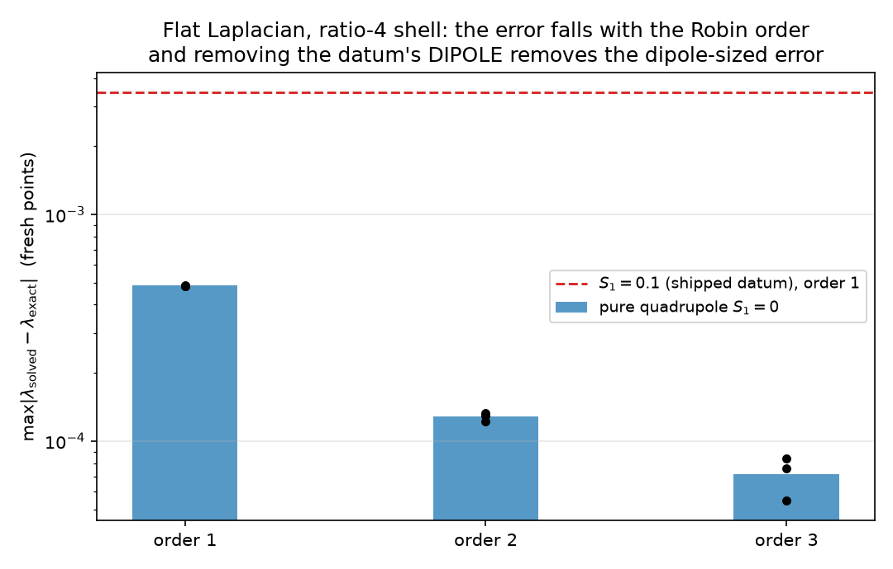
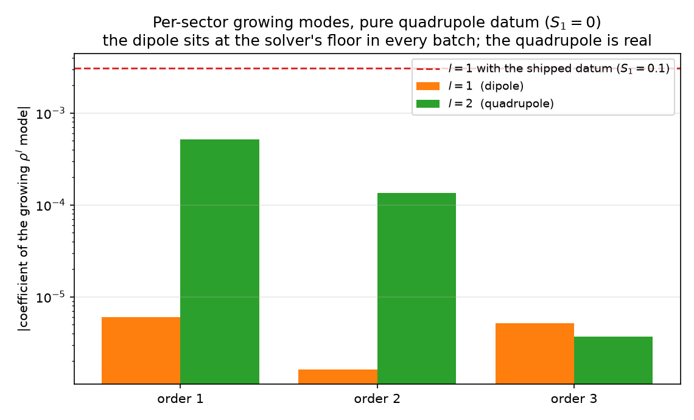
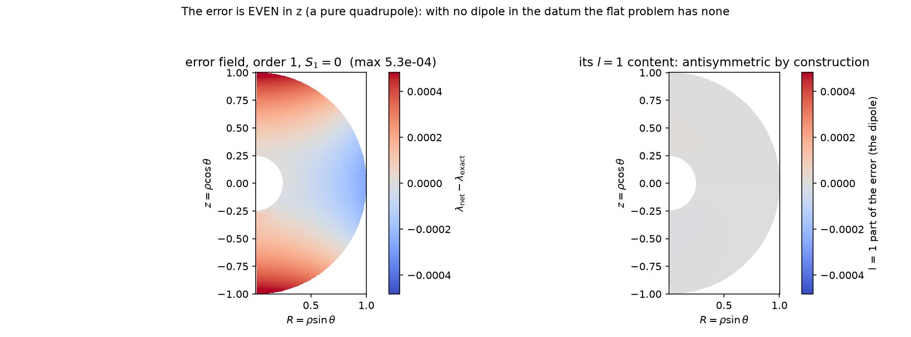
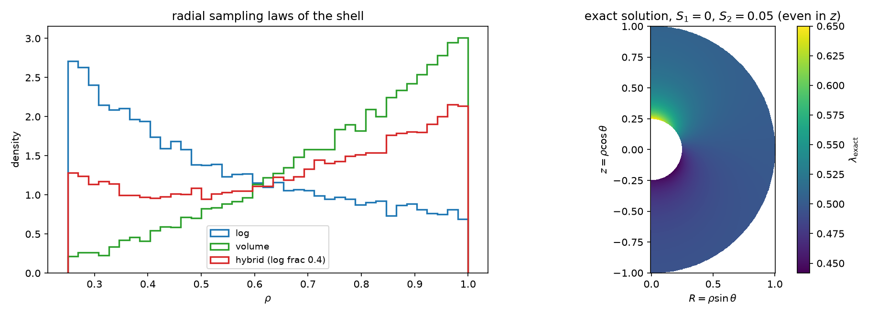
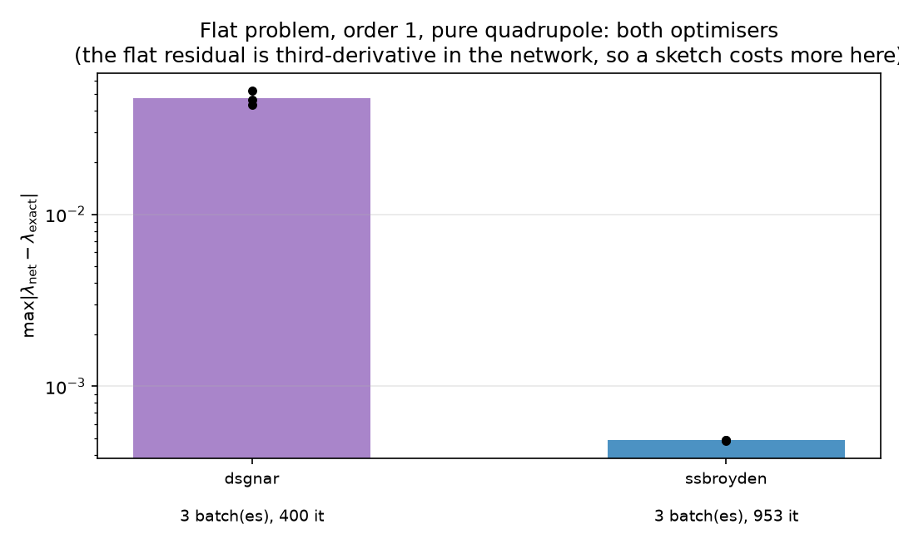
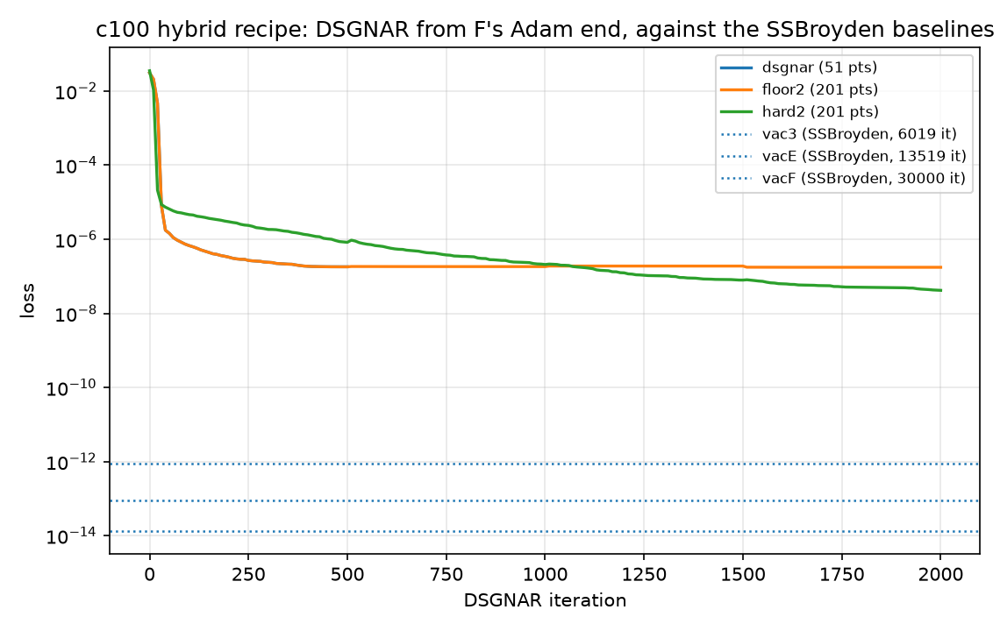

# The spurious dipole in a flat-Laplacian reduction

*Does the `lambda`-equation's tail dipole come from the formulation, or does it need the full
system?*  This note answers that for the reduced problem described in `Laplace_Robin.md` — flat
`Delta lambda = 0` with a manufactured Robin condition — by running it with a **pure quadrupole**
inner datum (`S1 = 0`), with **independent batches**, a **hybrid radial sampling law**, and with
**both optimisers**.

The short answer: **no dipole appears.**  Remove the dipole from the datum and the `l = 1` growing
coefficient drops from 3.07e-03 to the solver's floor, ~5e-06, five hundred times below the
quadrupole coefficient that survives.  So in this reduction the dipole is strictly data-driven.
The production runs have the same `S1 = 0` datum and a dipole of 1.1e-02 (soft inner BC) to 3.7e-01
(hard inner BC), which therefore has to come from what the reduction leaves out — the metric.

---

## 1. Why this reduction

The c100 hybrid runs (`pq_r100_phihyb025_*`) impose `lambda = lam0 + S2 (3 n_z^2 - 1)/2` on the
inner sphere: **no dipole in the data**.  Their solutions nevertheless end with a spurious tail
dipole, `|S_10| = 2.6e-02` (76-508 DSGNAR iterations), 1.07e-02 (2000 iterations, soft inner BC)
and 3.67e-01 (2000 iterations, hard inner BC).  Two readings were on the table:

* the dipole is a **kernel mode** of the objective — a homogeneous solution that the loss cannot
  see, so nothing pins it;
* the dipole needs the **full system** — the metric's angular content entering `Delta_h lambda`.

The flat reduction keeps the equation, the datum, the shell ratio, the Robin condition and the
sampling, and removes only the metric.  It is the cleanest discriminator available, and in the
ratio-4 shell the Robin order is the thing that decides the field (`Laplace_Robin.md` Sec. 6.3).

## 2. The problem, and the one number that frames everything

    Delta lam = 0                                     rho_in = 0.25 < |x| < rho_out = 1
    lam       = lam0 + S1 n_z + S2 (3 n_z^2 - 1)/2                          |x| = rho_in
    B_n[lam - lam0] = 0                                                     |x| = rho_out

`B_n = prod_{i<n} (theta + 1 + i)` with `theta = rho d_rho`, so it annihilates `rho^-1 ... rho^-n`
and nothing else in the power family.  The exact field is the decaying multipole sum
`lam_exact = lam0 + S1 rho_in^2 z/rho^3 + S2 rho_in^3 (z^2 - (x^2+y^2)/2)/rho^5`.

`LapNet` (the test's network: `[n_x,n_y,n_z,t,rho_in/rho]`, six `tanh` layers of width 20, linear
head, `lam = lam0 + u`) has **2241 parameters against 352 residual rows** (256 collocation + 48
inner + 48 outer).  The batch residual is therefore *saturable*: what is measured on fresh points
is not an optimisation error but a **selection** among the many fields that fit the sample.  That
framing matters below, for the optimiser comparison and for the production dipole alike.

## 3. Method

`laplace_probe.py` (new) drives the test's solver with three additions the shipped tests do not
have:

* **independent batches** — each draw gets fresh collocation, inner and outer points, and the error
  is measured on 4096 *different* fresh points (seed `9 + batch`);
* **the hybrid radial law** (`sample_shell`'s mixture: `log-frac` of the shell points log-uniform,
  the rest uniform in volume), here `log-frac = 0.4`;
* **either optimiser** — the test's SSBroyden (`train._crunch_minimize`, full inverse Hessian) or
  the doubly-sketched Gauss-Newton phase (`dsgnar.dsgnar_phase`, with an in-phase *resample*
  returning a fresh batch every `--resample-every` iterations).

The error is decomposed per angular sector by projecting onto the two homogeneous radial powers of
the flat Laplacian, `rho^l` (growing) and `rho^{-(l+1)}` (decaying).  For the shipped datum this
reproduces the `A = 3.07e-03` of `Laplace_Robin.md` Sec. 6.3 exactly, which is the check that the
decomposition measures the documented quantity.

## 4. Results

### 4.1 The dipole is data-driven and nothing else

SSBroyden, three independent batches, hybrid sampling, `S1 = 0`, `S2 = 0.05`:

| order | max\|err\| (3 batches) | `l = 1` growing `rho^1` | `l = 2` growing `rho^2` |
|---|---|---|---|
| 1 | 4.820e-04, 4.883e-04, 4.844e-04 | -1.30e-05, +4.54e-06, -4.48e-07 | **+5.22e-04, +5.20e-04, +5.19e-04** |
| 2 | 1.292e-04, 1.222e-04, 1.331e-04 | +2.16e-06, -2.37e-06, +3.69e-07 | **-1.33e-04, -1.35e-04, -1.36e-04** |
| 3 | 7.582e-05, 8.378e-05, 5.484e-05 | +3.91e-06, +3.01e-06, +8.66e-06 | -4.25e-06, -1.48e-07, -6.63e-06 |





For contrast, the shipped datum (`S1 = 0.1`) at order 1 gives `max|err| = 3.45e-03` with an `l = 1`
growing coefficient `+3.07e-03` — the red lines in both figures.  Setting `S1 = 0` removes 99.8 % of
the error and takes `l = 1` down by two to three orders of magnitude, to the solver's floor, while
the `l = 2` coefficient stays at 5.2e-04 in every batch.  Going to order 2 divides the spurious
quadrupole by 4, and order 3 takes it to the floor as well; the `l = 1` sector never moves.

The mechanism is not a coincidence of the numerics: with no `l = 1` in the datum, the growing and
decaying `l = 1` harmonics must cancel at `rho_in` (`a rho_in + b/rho_in^2 = 0`), and since `B_n`
does **not** annihilate `rho^1`, the outer condition forces `a = 0`.  In this problem the dipole has
nowhere to hide.

### 4.2 What the error field looks like



The solved error (order 1, one batch) is **even in `z`** — the two poles carry the same sign — and
its `l = 1` projection is grey at the 1e-05 level on a 5e-04 scale.  Visually, a pure quadrupole.

### 4.3 The sampling



Left: the three radial laws of `sample_shell` on this shell; the hybrid one (40 % log-uniform, 60 %
volume-uniform) is what the runs use.  Right: the exact field, even in `z`, with the dipole absent
by construction.

### 4.4 Both optimisers, and why the flat problem flatters one of them



| optimiser | settings | iterations | max\|err\| (3 batches) |
|---|---|---|---|
| SSBroyden (full inverse Hessian) | `gtol 1e-7` | 801-1053 | 4.82e-04 … 4.88e-04 |
| DSGNAR (sketched GN) | `s = 64`, 400 steps, resample 100 | 400 | **4.33e-02 … 5.26e-02** |

Two orders of magnitude apart, and I would not read that as a verdict on the optimiser:

* the flat residual contains `rho^2 Delta lam` **with `Delta` of the network**, so a JVP of it is a
  *third*-derivative computation.  Measured cost: >8 s per DSGNAR iteration at `s = 256`, against
  ~2.3 s at `s = 128` in production, where the residual's highest derivative is the second.  The
  `s = 256`/`s = 512` flat reruns therefore take hours, not minutes;
* SSBroyden here is *full-memory* on a **linear** least-squares problem (the head is linear, the
  residuals are linear in the parameters) of 2241 unknowns against 352 equations.  That is its ideal
  case, and it is exactly where a sketched Gauss-Newton (a randomised subspace correction in `s` of
  2241 dimensions) is worst;
* DSGNAR's own multipole content on this problem is not interpretable: at 4.3e-02 its solution is
  nowhere near the exact field, and the per-sector fits are 4.7e-02, i.e. the error is not even
  described by the two leading powers.  Only the converged (SSBroyden) fields support a physical
  reading.

The meaningful optimiser comparison is the production one, on the same objective for both methods:



From F's Adam end on the c100 hybrid recipe, DSGNAR takes the loss from 3.1e-02 to 1.75e-07 in 2000
iterations (75 min) without the hard inner BC, and to **4.17e-08** with it; SSBroyden reaches
8.85e-14 (vacE, 13519 iterations) and 1.33e-14 (vacF, 30000 iterations, 62 min).  In *loss* terms
DSGNAR is 6-7 orders behind; in *raw residuals* the gap is 3-4 orders (`gauge` 5.4e-07 vs 1.2e-10,
`lam_eq` 8.7e-09 vs 1.3e-10, `ricci` 4.0e-09 vs 2.0e-09), and the `lambda` profile is already
identical to F's to seven digits.  DSGNAR is a usable optimiser here, not yet a competitive one.

## 5. What this means for the production dipole

The reduction has the same equation, the same `S1 = 0` datum, the same shell ratio, the same Robin
condition and the same sampling discipline, and produces no dipole at all.  So the production dipole
is **not** an artefact of the formulation, and it is **not** a kernel mode that the objective
cannot see.  The one ingredient the reduction removes is the metric, and the lambda equation is
`Delta_h lambda`: `l = 1` content **in `h`** is an `l = 1` source for `lambda`.  In the production
runs the metric's boundary weights are switched off (`inner_h = 0, outer_h = 0`), so `h` is only
weakly controlled there, which makes the metric the leading suspect.

The test that follows is cheap and I have the tooling: decompose `h` itself (and `lambda`) into
multipoles at several radii on `floor2` and `hard2`.  If `h` carries `l = 1` where `lambda` does,
the source is identified; if `h` is clean in `l = 1`, the culprit is the Ricci/gauge coupling.

## 6. Caveats, and what would falsify the conclusion

* **Sampling mismatch.**  The runs *train* on hybrid points and the error is measured on the run's
  default (log-uniform) fresh draw, so the `max|err|` columns carry a sampling mismatch.  The
  multipole coefficients are the robust statement — they are properties of the converged field, and
  they are stable across batches (order 1 `l = 2`: 5.19-5.22e-04 over three independent draws).
* **The batch residual is saturable** (2241 parameters, 352 rows), so a low `max|err|` is evidence of
  a good selection, not of a hard fit.  A falsification of Sec. 4.1 would be a nonzero `l = 1`
  growing coefficient in a *converged* solve with `S1 = 0` — it stayed at the floor in all nine
  solves here.
* **The production conclusion is an inference**, not a measurement: the reduced problem cannot
  produce a dipole, therefore the production one has another source.  The metric decomposition of
  Sec. 5 is the measurement that would settle it.

## 7. Reproducing

```bash
cd Stationary
# the table of Sec. 4.1 (SSBroyden, three batches, orders 1-3)
./.venv/bin/python laplace_probe.py --optimizer ssbroyden --order 1 --s1 0 --s2 0.05 --batches 3
./.venv/bin/python laplace_probe.py --optimizer ssbroyden --order 2 --s1 0 --s2 0.05 --batches 3
./.venv/bin/python laplace_probe.py --optimizer ssbroyden --order 3 --s1 0 --s2 0.05 --batches 3
# the sketched optimiser (slow: third derivatives), with in-phase resampling
./.venv/bin/python laplace_probe.py --optimizer dsgnar --order 1 --s1 0 --s2 0.05 \
    --batches 3 --dsgnar-steps 400 --dsgnar-sketch 64 --resample-every 100
# numbers -> JSON -> figures
./.venv/bin/python collect_flat_results.py
./.venv/bin/python make_flat_figures.py
```

Artifacts: `laplace_probe.py`, `collect_flat_results.py`, `make_flat_figures.py`,
`plots/flat_probe_*.log` (raw probe output), `plots/flat_results.json` (parsed),
`plots/flat_*.png`, `plots/production_convergence.png`.  The production histories are
`runs/pq_r100_phihyb025_{dsgnar,floor2,hard2}/history.json` on the hub.
