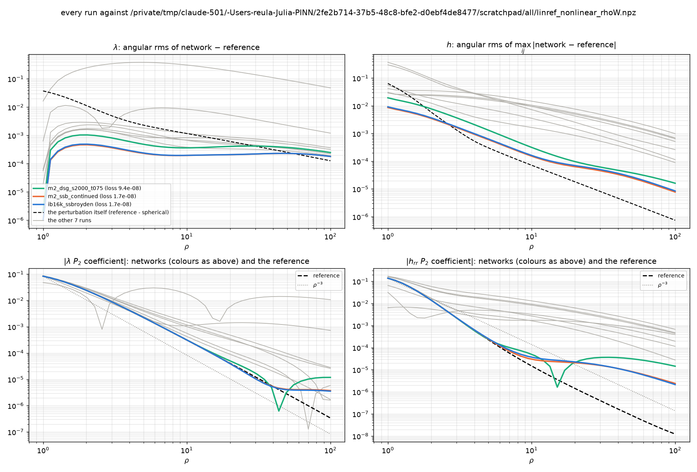

# Perturbation analysis: a quadrupole datum on a spherical background

The runs impose an angular inner datum `lambda(rho_in) = lambda0 + S2 P2(cos theta)` with
`S2 = -1/12 = -0.0833`, on a background that is the spherically symmetric Weyl solution of mass
`M = R0 = 1/sqrt(3) = 0.5774` (`lambda_B = (r-M)/(r+M)`, `lambda0 = 1/3` at the inner sphere).
This note records what the leading response should be, and then what the runs actually show.

## 0. Expansion parameter, and what the expansion can be trusted for

Perturb the logarithm and the metric: `lambda = lambda_B exp(dphi)`, `h = h_B + dh`. At the inner
sphere the datum gives

    dphi(rho_in) = (S2/lambda0) P2 = 0.25 P2,

so the **relative** perturbation is 25 %, not 8 %.  Consequences, stated once and used throughout:

* the *structure* -- which powers of rho appear, in which angular mode -- is exact;
* the *amplitudes* are indicative only: the neglected second-order terms are `O(0.0625)`.

Because the background is spherically symmetric and the chart is harmonic (`x^i = rho n^i`), the
angular functions on a sphere of constant `rho` are exactly `P_l(cos theta)`, and the linearised
equations are diagonal in `l`.  So a pure `l = 2` datum produces, at linear order,

    only l = 2.   No l = 1.  No change in l = 0.

That is the sharpest statement here, and it is testable (section 3).

## 1. Leading terms

    quantity        l = 0                                l = 2                     l = 1
    phi = ln lambda lambda_B, i.e. 1 - 2M/rho + ...      A(rho) P2, A -> a2 rho^-3  0
    lambda          1 - 2M/rho + 2M^2/rho^2 - ...        lambda_B A, -> a2 rho^-3   0
    P (Geroch)      M/rho + M^3/rho^3 + ... (= x/(1-x^2), x = M/rho)   -> a2' rho^-3   0
    h_rr - 1        O(rho^-3)                            -> b2 rho^-3               0
    g2 - 1          -M^2/rho^2 - M^4/rho^4 - ...         -> c2 rho^-3               0

Read off:

1. **The l = 2 response is linear in S2 and decays as rho^-3**, in the scalar *and* in the metric:
   the metric's source is the cross term `d_a lambda_B d_b (d lambda)`, itself `O(S2)`.  A
   quadrupole datum therefore *must* show up in the metric at the few-per-cent level.  What has to
   be checked is not its presence but its **radial power**.
2. **rho^-2 is occupied twice** in lambda (`2M^2`, from the exponential) and in g2 (`-M^2`), and
   also by the `l = 1` dipole.  A radial operator cannot separate angular modes from powers, which
   is why the scalar condition moved to `P` (whose `l = 0` part has no rho^-2 at all) and why the
   metric condition must be left alone.
3. **`l = 1` vanishes at linear order.**  Whatever `l = 1` content a run has is second order in
   `S2` (`S2^2 = 6.9e-3`), a coordinate offset (the origin not at the centre of mass), or
   numerical.
4. **The `l = 0` back-reaction of the quadrupole is `O(S2^2/rho^6)`**: a few 1e-3 at rho = 1, and
   1e-14 at rho = 100.  So the mass and the far-field level are untouched by the quadrupole, and
   the agreement of `lambda(rho_out)` with the spherical value is meaningful.
5. The scalar kernel `{1,3,4}` on `P` annihilates `rho^-1` and `rho^-3`, forces `rho^-2` (the
   dipole) to vanish, and its first unintended victim is `rho^-5`, whose coefficient is
   `O(M^5) = 0.06` -- i.e. `6e-12` at rho = 100.  Below anything measured here.

## 2. The radial equation in the scalar sector

Writing `phi = phi_B + delta` and keeping linear order, the equation `Delta_h phi = 0` becomes, on
the spherical background,

    Delta_{h_B} delta = 0,        delta = sum_l A_l(rho) P_l(cos theta).

The background is static and spherically symmetric, so the angular part is the ordinary sphere
Laplacian and each `l` decouples.  The chart is harmonic but *not* areal-spherical, so the radial
operators are not the flat ones; asymptotically, however, the two solutions of the `l`-th radial
equation behave as `rho^{-(l+1)}` and `rho^{l}` plus subleading powers.  The inner datum fixes the
mixture at `rho_in` and the outer decay condition selects the falling branch, so

    A_l(rho) = a_l rho^{-(l+1)} (1 + O(1/rho^2)),        l = 2: a2 rho^-3.

That `O(1/rho^2)` is the reason the *multipole coefficient* `S_l = rho^{l+1} A_l` is not
rho-independent at moderate rho: it approaches its asymptotic value only as the subleading powers
die away.  **A drift measured over rho = 1 ... 100 is therefore not evidence of anything; it must
be measured in the asymptotic zone.**

## 3. The check, measured

`S_l(rho) = rho^{l+1} * (2l+1)/2 * integral f P_l dmu` on Gauss-Legendre nodes, at rho = 25, 50, 100
so that the subleading powers are small.  A clean multipole has S_l rho-independent; the
*amplitude* is `a_l = S_l / rho^{l+1}`.

    run                                        l=2: S_2 at 25 / 50 / 100          amplitude a_2
    pq_r100_phihyb025_R0   h_rr   -4.59e+02  -3.69e+03  -2.87e+04   drift 98%   ->  -2.9e-02  CONSTANT
    pq_r100_phihyb025_S1   h_rr   -4.64e+02  -3.77e+03  -2.98e+04   drift 98%   ->  -3.0e-02  CONSTANT
    pq_r100_phihyb025_S2   h_rr   -2.49e+02  -1.74e+03  -8.60e+03   drift 97%   ->  -2.9e-02  CONSTANT
    pq_r100_phihyb025_S4   h_rr   -3.18e+01  -8.73e+01  -2.05e+02   drift 84%   ->  -2.0e-03 ... -2.1e-04

The verdict is the opposite of "not settled yet":

* **S1, S2 and R0 carry an `l = 2` metric part that does not decay at all**: `a_2` is `-0.029` at
  rho = 25, 50 *and* 100.  A constant is `rho^0`, which the Robin window `{rho^-2, rho^-3, rho^-4}`
  *forbids*: this is not the physical `rho^-3` response but the forbidden mode, and it is exactly
  the ~2-3 % offset seen on the `h_rho_rho` equator panel.
* **S4 (four shells) does decay**: `a_2 = -2.0e-3, -7.0e-4, -2.1e-4`, i.e. roughly `rho^-1.7` over
  this range.  Not yet `rho^-3`, but the forbidden constant is gone, which is the effect the
  four-shell ladder was supposed to have.  (S4 differs from S2 in two ways -- four shells versus
  three, and hybrid versus log sampling -- so this cannot be credited to the shell count alone.)
* In the scalar sector `P`'s `l = 2` decays as well (`S4`: 1.11, 1.93, 2.84, i.e. `a_2` falling
  roughly as `rho^-2.3`), and `P`'s `l = 1` is at the `1e-4 ... 1e-7` level, i.e. small.

## 4. The scaling test (the prediction this note exists for)

Halve the datum and the linear analysis predicts:

    l = 2 amplitudes:  half            (linear in S2)
    l = 1 amplitudes:  a quarter       (there is no linear l = 1; it can only be O(S2^2))
    l = 0 quantities:  unchanged to ~1e-12

    RHO_OUT=100 TAG=_Q2 SHELLS=1.0,0.9,0.8,0.7 NCOLL=16384 NBND=1024 RADIAL=log \
        EXTRA="--lam-bc-S2 -0.0416666667" bash run_s2.sh

If `l = 1` falls by 4, it is second order and harmless; if it falls by 2, something enters that the
analysis above has missed; if it does not fall at all, it is a coordinate offset and the answer is
the centre-of-mass condition, not another decay kernel.

## 5. A reference that solves the problem: `stationary/specref.py` (2026-10-15)

*Names (2026-10-16): the module was `linref.py`, which fits only the linear solve; it is
`specref.py` now, with the output files `specref_linear.*` and `specref_nonlinear.*`.  "The linear
reference" is the l = 2 first-order solve, "the nonlinear reference" the Gauss-Newton one.  Files
from before the rename are `linref_*` on disk and are still read.*

With a quadrupole datum there is no closed-form solution, and `--ref-solution` is the SPHERICAL
member: the report's `rms_dh`, `rms_dlam`, `max_dlam` measure the distance to it, which includes the
physical quadrupole, so they are not errors.  `specref.py` builds a reference that does solve the
problem, so that runs (and optimisers) can be graded against something.

### 5.1 What it is

The field is the spherical background `exact_asset(cfg)` -- i.e. S0, through `lam0` and `R0` --
plus an axisymmetric, reflection-even perturbation expanded in Legendre modes `l` and, radially,
in Chebyshev polynomials of `log rho` on `[rho_in, rho_out]`:

    delta lambda = sum_l f0_l(rho) P_l
    delta h_ij   = sum_l [ f1_l P_l delta_ij + f2_l P_l n_i n_j
                           + f3_l P_l' (e_i n_j + n_i e_j)
                           + f4_l P_l'' (e_i e_j - (1 - mu^2)/2 (delta_ij - n_i n_j)) ]

with `mu = z/rho` and `e = z_hat - mu n`.  For each `l` that is the complete even-parity set
(h_rr, h_rA, the tangential trace, the tangential trace-free part); `l = 0` has only the first two.
Gamma is the metric's Christoffel symbol, as in the metric-only (hybrid) runs.

The residual is `losses.residual_vector` itself, through a model-like wrapper: the run's PDE
(Ricci, harmonic gauge, lambda equation), its inner datum, its outer Robin ladder, its pins and its
weights.  So the reference solves **the same boundary-value problem the network is trained on**,
read from the run's own `config.json`.

### 5.2 Two modes

| mode | modes | solve | what it is |
|---|---|---|---|
| linear (default) | `l = 2` | one least-squares step `J c = -r(0)` at the background | the first-order response to S2, with S0 and S2 as parameters: PERTURBATION.md sections 1-2 made quantitative |
| `--nonlinear` | `l = 0, 2, 4, 6(, 8)` | Gauss-Newton on the full residual | the full axisymmetric solution, to the truncation of the basis |

The relative perturbation at the inner sphere is 25% (section 0), so the linear solution misses
second-order terms of a few per cent of the perturbation itself.  That is fine for physics (the
structure, the decay powers, the scaling with S2) and is what the closed form (section 6, to be
written) has to reproduce; it is too coarse to grade runs whose loss is 1e-8.  The batch therefore
grades runs against the NONLINEAR reference; the linear one is the physics check and the bridge to
the closed form.

    ./.venv/bin/python -m stationary.specref runs/<run>                       # linear
    ./.venv/bin/python -m stationary.specref runs/<run> --nonlinear --ls 0,2,4,6,8 --n-radial 36

writes `runs/<run>/specref_{linear,nonlinear}.{npz,json}` (coefficients, solve history, and the
run's network against the reference: pointwise rms/max of `|h - h_ref|`, `|lam - lam_ref|`, and
the `P_l` coefficients of lambda and h_rr at rho = 1 ... 100).  The Jacobian is built in blocks of
32 tangents.  On the Mac (CPU) a linear solve takes ~16 min and a nonlinear one ~15-20 min, almost
all of it the first compilation; `run_batch_sketch.sh` runs the nonlinear one on the hub's GPU for
every `ib16k_*` arm.

### 5.2b The comparison figure

Every `specref` call also writes `runs/<run>/specref_<mode>.png`: four panels against rho (log-log) --
the `P_2` coefficient of lambda and of h_rr, network against reference (with a rho^-3 guide), and the
angular rms of `lam_net - lam_ref` and of `max_ij |h_net - h_ref|`, each next to the size of the
perturbation itself (reference - spherical), the scale the miss is read on.  The profiles are saved
in `specref_<mode>.json` as well.  `--reuse` takes the coefficients from an existing
`specref_<mode>.npz` instead of solving again: the reference depends only on the PROBLEM, so one
solve serves every run of the same recipe (the corrected pq16k recipe's reference, l <= 6, 24 radial
modes, loss 3.0e-9, was copied into each `ib16k_*` run on the hub on 2026-10-16).

**The far field of the reference (2026-10-16).**  `specref` now prints, per radius, the P_2
coefficient of the GH potential P, its log-slope and the P_0/P_2 parts of the outer Robin operator
on P (`farfield`).  For the current reference (l <= 6, 24 radial modes, loss 3.0e-9):

    rho     P2 coeff   slope   Robin(P) l=0   Robin(P) l=2
     10    1.76e-04    -3.02    -5.5e-04       -1.4e-05
     20    2.20e-05    -2.96    -5.2e-04        3.5e-05
     30    7.08e-06    -2.45    -7.3e-04        4.5e-05
     50    3.04e-06    -0.50    -9.3e-04        1.6e-04
     70    3.43e-06    +0.88    -5.7e-08        6.6e-09      <- Robin ladder: 70, 80, 90, 100
    100    4.13e-06    +0.04    -7.1e-10        2.5e-11

The basis is converged (Chebyshev coefficients of the l = 2 lambda part fall to 1e-9; 8 of the 24
nodes lie beyond rho = 38), and the Robin condition holds where it is imposed.  But the tail is
-3 only to rho ~ 20: between 30 and 70 the field is not the decaying tail the condition
annihilates.  The residual floor (per-point rms ~5e-5 after the rho^2 scaling) is larger than the
l = 2 signal there (3e-6), so the solve does not determine it.  Two variants test this, with the
new flags `--scale-exps` (the rho exponents, all +2: 3,4,3,4) and `--outer-shell-fracs` (the
ladder extended to 0.5 and 0.35), each written under `--tag` so the reference is not overwritten.

Result of `--scale-exps 3,4,3,4 --tag rhoW` (hub, 2026-10-16; the same basis, sample and data):

    rho     P2 coeff   slope   Robin(P) l=0   Robin(P) l=2
     10    1.76e-04    -3.02    -1.0e-05       -1.3e-05
     20    2.19e-05    -3.00    -7.9e-06       -6.1e-07
     30    6.48e-06    -3.00    -7.6e-06       -2.4e-07
     50    1.40e-06    -3.00    -7.6e-06       -1.4e-07
     70    5.08e-07    -3.02    -7.6e-06       -1.8e-07
    100    1.72e-07    -3.09    -3.4e-06        6.0e-07

The tail is rho^-3 to rho_out, in lambda and in h_rr (whose P_2 coefficient is -1.2e-8 at rho = 100,
the rho^-3 continuation of its value at 25).  So the far field of the rho^2-scaled reference was
under-determined, not wrong in its basis: the residual floor hid it, and weighting the far rows by
another rho^2 determines it.  Its loss (4.5e-7) is not comparable with the 3.0e-9 above: the
residual is weighted differently.  Inside rho ~ 10 the two references agree.

**Consequence: the far-field misfit is the network's.**  Against the rhoW reference,
`ib16k_ssbroyden`'s lambda P_2 coefficient flattens at ~4e-6 from rho ~ 40 (reference 3e-7 at
100) and its h_rr P_2 coefficient flattens from rho ~ 8 (2e-6 at 100, reference 1.2e-8); the
old reference had the same flattening, so the comparison against it showed agreement there.  The
networks train with the same rho^2 scaling, so they plausibly carry the same under-determination
(untested).  `specref_nonlinear_rhoW.npz` is the reference to grade against from now on;
`stationary.specref_summary` draws every run's error against it, and `specref.load_reference`
(the report's VS NONLINEAR REFERENCE section, `P_multipoles_outer.png`) takes it before the
rho^2 one when a run has both (`REFERENCE_TAGS`).  The ladder variant (Robin shells at
1, 0.9, 0.8, 0.7, 0.5, 0.35 of rho_out, rho^2 weighting; Mendieta, 2026-10-16) does NOT fix it:

    rho     P2 coeff   slope   Robin(P) l=0   Robin(P) l=2
     10    1.77e-04    -3.01    -1.1e-03        9.3e-05
     20    2.29e-05    -2.94    -1.2e-03        9.6e-05
     30    7.60e-06    -2.23    -5.1e-04       -2.5e-05
     50    3.13e-06    -1.41    -7.1e-07        2.4e-07      <- shells: 35, 50, 70, 80, 90, 100
     70    2.57e-06    +1.18    -6.4e-07        3.6e-08
    100    3.63e-06    -0.17    -5.4e-09       -4.7e-10

The condition now holds on the shells at 35 and 50 as well, and the tail is still not rho^-3.  A
plausible reason (not tested): the kernel {1, 3, 4} acts on every l, so an l = 2 rho^-1 term --
not a solution of the equations, but annihilated by the operator -- passes the condition at any
radius, and only the interior residual can exclude it, which at rho^2 weighting it does not.
Weighting (rhoW), not more shells, is what determines the far field.

**Every run against the rhoW reference** (`stationary.specref_summary`, 2026-10-16; angular rms of the
difference, per radial region, next to the size of the perturbation itself):

| run | final loss | rms dlam 1-3 | rms dlam 3-10 | rms dlam 10-30 | rms dlam 30-100 | rms dh 1-3 | rms dh 3-10 | rms dh 10-30 | rms dh 30-100 |
|---|---|---|---|---|---|---|---|---|---|
| *perturbation itself* | -- | *2.0e-02* | *2.5e-03* | *7.6e-04* | *2.6e-04* | *2.2e-02* | *4.5e-04* | *3.1e-05* | *3.5e-06* |
| `ib16k_ssbroyden` | 1.7e-08 | 4.1e-04 | 2.5e-04 | 2.1e-04 | 2.2e-04 | 5.1e-03 | 7.5e-04 | 9.2e-05 | 2.9e-05 |
| `m2_ssb_continued` | 1.7e-08 | 3.8e-04 | 2.4e-04 | 2.1e-04 | 2.2e-04 | 4.8e-03 | 7.1e-04 | 8.5e-05 | 2.6e-05 |
| `m2_dsg_s2000_t075` | 9.4e-08 | 8.6e-04 | 5.1e-04 | 4.0e-04 | 3.6e-04 | 1.1e-02 | 1.6e-03 | 1.5e-04 | 3.7e-05 |
| `m2_dsg_s1100_t075` | 1.8e-06 | 1.4e-03 | 7.5e-04 | 3.4e-04 | 2.7e-04 | 1.7e-02 | 3.2e-03 | 1.0e-03 | 2.8e-04 |
| `m2_dsg_s1100_t15` | 2.2e-05 | 1.4e-03 | 1.0e-03 | 5.7e-04 | 3.4e-04 | 2.5e-02 | 1.7e-02 | 6.8e-03 | 2.0e-03 |
| `ib16k_paperNW_s1100` | 4.1e-05 | 1.9e-03 | 1.3e-03 | 5.2e-04 | 3.3e-04 | 3.5e-02 | 2.4e-02 | 9.4e-03 | 2.8e-03 |
| `m2_dsg_stage1` | 1.0e-04 | 1.3e-03 | 9.4e-04 | 7.6e-04 | 4.8e-04 | 2.4e-02 | 1.5e-02 | 6.1e-03 | 1.8e-03 |
| `ib16k_paper_s1100` | 2.4e-04 | 2.5e-03 | 1.8e-03 | 9.4e-04 | 5.7e-04 | 2.5e-02 | 7.2e-03 | 2.0e-03 | 4.0e-04 |
| `ib16k_paperNW_s512` | 1.3e-03 | 7.6e-03 | 8.1e-03 | 6.0e-03 | 2.3e-03 | 1.4e-01 | 2.1e-02 | 3.8e-03 | 7.0e-04 |
| `ib16k_adam` | 6.4e-02 | 2.2e-01 | 3.6e-01 | 2.2e-01 | 9.1e-02 | 1.6e-01 | 2.2e-02 | 5.3e-03 | 1.4e-03 |

Read off:

1. **The error ranks the runs as the loss does.**  SSBroyden (loss 1.7e-8) is the most accurate
   everywhere; DSGNAR s = 2000 (9.4e-8) is about 2x worse in lambda and in h; the rest follow
   their losses.  A lower loss is a smaller error here, so the optimiser comparison by loss stands.
2. **lambda: the best runs sit 1-2 orders below the perturbation inside rho ~ 10**, but their
   error is flat at ~2e-4 from rho = 3 to 100, so it exceeds the perturbation beyond rho ~ 50.  A
   floor that does not decay with rho is not in the l = 2 part (whose miss is ~4e-6 at rho = 100):
   by elimination mostly l = 0, the level of lambda (not separated here).
3. **h: every run's error is larger than the perturbation from rho ~ 3 out** (SSBroyden: 7.5e-4
   against 4.5e-4 at 3-10, 2.9e-5 against 3.5e-6 at 30-100).  The h_rr P_2 coefficient of the
   networks flattens from rho ~ 8 (bottom right) where the reference keeps rho^-3: the far-field
   metric quadrupole is not learned by any of the runs.

### 5.3 What it found: the inner condition over-determined the problem

All on the `pq` recipe (S2 = -1/12, R0 = 1/sqrt3, rho in [1, 100], four outer shells), compared
with `runs/sk16k_ssbroyden` (SSBroyden, loss 3.1e-5), 1500 collocation points, 24 radial modes.

**Under the old inner condition** (`h - h_rr n n = c (I - n n)`, which also set `h_rA = 0`):

| | linear (l = 2) | nonlinear (l <= 6) |
|---|---|---|
| reference loss on its own points | 1.8e-3 (second-order terms) | **1.8e-5, a floor** -- Newton stalled after 2 steps |
| h_rr's `P_2` coefficient, rho = 10 / 25 / 100 | -3.0e-2 / -2.3e-2 / -1.1e-2 | **-4.9e-2 / -4.5e-2 / -4.1e-2: not decaying** |
| lambda's `P_2` coefficient, rho = 50 -> 100 | halves (rho^-1) | halves (rho^-1) |
| network - reference, rms in lambda / h | 1.8e-3 / 2.9e-3 | 3.0e-4 / 1.7e-2 |

The best least-squares fit to the run's own problem kept the non-decaying `l = 2` metric part of
section 3 and could not go below a loss of ~2e-5 -- the same level as the networks.  Counting
constants explains it: in harmonic gauge the `l = 2` sector has five second-order radial equations,
ten constants, five left after decay; the inner sphere fixes five (the lambda datum, the trace and
trace-free parts of the induced metric, the two components of the gauge condition), and `h_rA = 0`
was a sixth.  No decaying solution existed.

**With the induced metric only** (`P h P = c P`, `P = I - n n`; the fix of commit 0773b6a, see
`losses.inner_bc_raw` and README section 5), same everything else, nonlinear:

| | |
|---|---|
| reference loss | **3.0e-9** (Newton converged in 3 steps; the rest is the basis) |
| lambda's `P_2` coefficient, rho = 10 / 25 / 50 | -3.1e-4 / -2.2e-5 / -5.9e-6  (rho^-2.9 from 10 to 25) |
| h_rr's `P_2` coefficient, rho = 5 / 10 / 25 | -2.3e-4 / -1.3e-5 / -2.6e-6  (decays) |
| size of the perturbation (reference - spherical), rms h / lambda | 1.1e-2 / 9.6e-3 |
| the OLD network against it, rms h / lambda | 3.5e-2 / 1.6e-3 -- three times the perturbation in h |

The non-decaying mode and the floor are gone, and the tails decay as section 1 predicts.  Every
Stationary run before 0773b6a solved the over-determined problem (they are in
`runs/_old_inner_condition/` on the hub).  The first run on the corrected problem,
`ib16k_ssbroyden`, went to a loss of 1.9e-8 where the same optimiser had stalled at 3.1e-5.

### 5.4 Open

* the LINEAR reference on the corrected problem, and its distance from the nonlinear one: how far
  first order can be trusted at S2 = -1/12 (expected: a few per cent of the perturbation);
* the closed form of the linear `l = 2` solution in harmonic gauge (the scalar couples to the
  metric through `d d phi_B`; in the vacuum reading the decaying static `l = 2` perturbation of
  Schwarzschild is a `Q_2(rho/M)` -- harmonic and prolate-spheroidal coordinates coincide on the
  background, `x = rho/M`, `y = cos theta` -- plus the harmonic-gauge correction), checked against
  the linear spectral solve;
* lambda's `l = 2` tail flattens to ~ -6e-6 between rho = 50 and 100 even on the corrected
  problem: the scalar kernel `{1, 3, 4}` on P admits rho^-1 in every `l` (section 1, item 5), so
  a small rho^-1 part is not excluded by the outer condition.  Whether it is that, or truncation,
  is not yet settled;
* the `ib16k_*` arms (hub, 2026-10-15) against the nonlinear reference.
