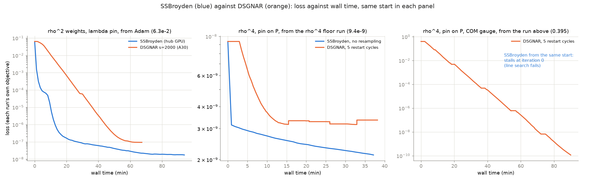

# Report: SSBroyden or DSGNAR?

*2026-10-18.  Every head-to-head comparison so far, on the Stationary problem (same network, 2285
parameters; each pair from the same start, with the same objective) and the windowed Evolution
problem.  Figure: `scripts/report_figures.py`; errors: `scripts/report_metrics.py` against the fine
nonlinear reference (REPORT_PIN_COM.md).*

## Summary

* **Near a solution, with a fixed objective, SSBroyden is slightly better.**  It reaches a 1.6-5x
  lower loss in about the same time, and its errors are equal or lower.
* **Whenever the start is far from the objective's minimum -- a new weighting, a new condition, new
  data -- SSBroyden fails and DSGNAR does not.**  SSBroyden stalled at iteration 0 both times
  (loss 1.2e4 under the new rho^4 weights; 0.395 under the new COM term), its first line search
  failing; DSGNAR took the same starts to 1.4e-6 and 1.2e-10.  The best result of the project so far
  (loss 1.16e-10, errors 5-6 orders below the perturbation) is DSGNAR's, from such a start.
* **In the windowed Evolution problem DSGNAR wins by ~6 orders** (6.3e-9 against 8.4e-3 at best).
* Their costs and failure modes differ (below); the recommendation is DSGNAR with restart cycles as the
  default, and SSBroyden to polish near a solution of a fixed objective.

## Head to head, Stationary

| setting (same start, same objective) | start loss | SSBroyden | DSGNAR | error (lambda rho 1-3 / h rho 1-3), SSB vs DSGNAR | verdict |
|---|---|---|---|---|---|
| rho^2, lambda pin, from Adam | 6.3e-2 | 1.74e-8, 94 min, 20000 it. (hub GPU) | 9.4e-8, 68 min, 234 it. (A30), s = 2000 | 4.1e-4 / 5.1e-3 vs 8.6e-4 / 1.1e-2 | SSBroyden, 2x |
| rho^4, lambda pin, from the rho^2 Adam | 1.2e4 | **stalls at iteration 0** | 1.4e-6, 88 min, 300 it. | -- | DSGNAR (only one works) |
| rho^4, lambda pin, from the result above | 1.44e-6 | 4.5e-7, 12 min | 4.6e-7, 18 min | identical (both at the pin's floor) | tie |
| rho^4, pin on P, from the result above | 9.4e-9 | 2.1e-9, 36 min, 10000 it. (cap, still falling) | 3.4e-9, 43 min, 5 restart cycles | residuals 10-30% lower for SSBroyden | SSBroyden, slightly |
| rho^4, pin on P, COM gauge, from the result above | 0.395 | **stalls at iteration 0** | **1.16e-10**, 94 min, 5 cycles, still falling ~60x per cycle | -- / errors 6.7e-8 / 4.8e-7 | DSGNAR |
| COM gauge, from DSGNAR's 1.16e-10 | 1.2e-10 | **3.75e-11, 8 min**, 1500 it. (plateau) | 3.96e-11, 39 min, 5 cycles (radius stops, few accepted after cycle 1) | 3.2e-8 / 1.4e-7 vs 3.5e-8 / 2.1e-7 | SSBroyden, 5x faster |

Losses are each run's own objective and comparable only within a row.  The first row ran on different
GPUs (SSBroyden on the hub, DSGNAR on a Mendieta A30).

## Head to head, windowed Evolution (Evolution_try, T = 20, 10 windows)

Best space-time relative L2 per hand-over (BATCH_REPORT.md, 30 runs):

| hand-over | DSGNAR best | SSBroyden best | ratio |
|---|---|---|---|
| soft_all | 6.3e-9 (s = 0.68 d, 8192 points) | 8.4e-3 | ~1e6 |
| soft | 1.6e-8 | 1.1e-2 | ~7e5 |
| hard | 2.7e-6 | 2.0e-2 | ~7e3 |

Each window starts far from its minimum (a new time interval), which is the regime where DSGNAR wins
on the Stationary problem as well.

## Costs and failure modes

| | SSBroyden | DSGNAR |
|---|---|---|
| state | dense inverse Hessian, d^2 (0.04 GB at d = 2285; 0.6 GB at 8.6k) | a sketched Jacobian, s columns per iteration |
| time per iteration | ~0.2 s (here) | ~17 s at s = 2000 (93% of it the s Jacobian-vector products); cost ~ s |
| typical run | 10^4 iterations | 10^2 iterations |
| host memory | grows ~3.3 MB per iteration: killed at 18250 iterations on a 64 GB node; jobs split into 10000 | flat |
| far start | first line search fails, stalls at iteration 0 (twice) | handles 1.2e4 -> 1.4e-6 and 0.395 -> 1.2e-10 |
| stopping | plateau rule (1% over 3 blocks of 250); resampling every 500 moves the loss by ~that much and can stop it early -> run with `--resample-every 0` | the trust radius collapses on one sample -> fixed by restart cycles (`--dsgnar-cycles`, fresh sample + fresh trust region) |
| main knob | none needed | sketch size: s = 1100 -> 2000 was 20x in the final loss; s must grow with d |
| reproducibility of the minimum | from the same start, both reach the same floor and the same solution (rows 3-4) | |

## The line search (2026-10-18)

All SSBroyden runs above used Crunch's **Armijo backtracking** (`bfgs_backtracking.py`): sufficient
decrease only (c1 = 1e-4), alpha starts at 1 and only shrinks (factor 0.1-0.5 per trial, 20 trials,
alpha >= 1e-12), and no curvature condition -- so y.s > 0 is not guaranteed and the inverse-Hessian
update can become indefinite.  Crunch also has the **strong-Wolfe** version (`bfgs.py`: JAX's zoom,
c2 = 0.9, two fallback tries), now selectable with `--qn-linesearch wolfe` (Config.qn_linesearch;
default "armijo" so older runs reproduce).  Smoke test on a tiny network (149 parameters) from a
start at loss 38.6: Armijo **0 iterations in each of 3 blocks** (status 3) -- the same stall as the
two runs above -- against Wolfe **38.6 -> 0.18 in 85 iterations**.  The two iteration-0 stalls of the
table were therefore the line search's, not SSBroyden's.  Reruns with Wolfe from those two starts
(Mendieta round 9):

| rerun with Wolfe | start loss | result |
|---|---|---|
| `m9_ssbw_rho4`: rho^4 from the rho^2 Adam (Armijo: 0 iterations) | 1.2e4 | **moves**: 1.1e-2 after 911 iterations -- but slowly (blocks end early on status-3 line-search failures, ~40 iterations each), and the job was killed at 60.6 GB of host memory after 97 min: the RSS growth is per `minimize` call, and failed blocks make many calls |
| `m9_ssbw_com`: COM term added (Armijo: 0 iterations) | 0.395 | **still stalls**: 1 iteration per block, status 5, loss unchanged |
| `m9_ssbw_com_nors`: the same, no resampling | 0.395 | stalls the same way |

So Wolfe fixes the far-start failure in one case (the new weights) but not the other (the new COM
term), where DSGNAR went 0.395 -> 1.16e-10: from that start the difficulty is the objective's
conditioning, not only the line search.  DSGNAR remains the tool for far starts.

## Recommendation

1. **Default: DSGNAR with restart cycles** (`--qn-method dsgnar --dsgnar-sketch ~0.9 d --dsgnar-cycles
   5 --dsgnar-cycle-steps 60`) -- whenever the problem, the weighting or a condition has changed, for new
   data, and for time windows.
2. **Then SSBroyden without resampling** (`--resample-every 0`, in jobs of 10000 iterations) to polish,
   once the loss is near the floor of a fixed objective.  From DSGNAR's 1.2e-10 COM solution it
   reached 3.75e-11 in 8 minutes, against DSGNAR's own continuation 3.96e-11 in 39 minutes, with
   slightly smaller errors -- both now at the reference's own level (2.8e-11).
3. **Wider networks shift the balance**: DSGNAR's cost grows with s ~ d (s = 2000 is 0.88 d now; for the
   8.6k-parameter network it would be ~2 min per iteration), SSBroyden's with d^2 memory.  The wide
   network was trained with SSBroyden for that reason.

Details: DSGNAR.md (sections 7-9), Evolution_try/BATCH_REPORT.md.
