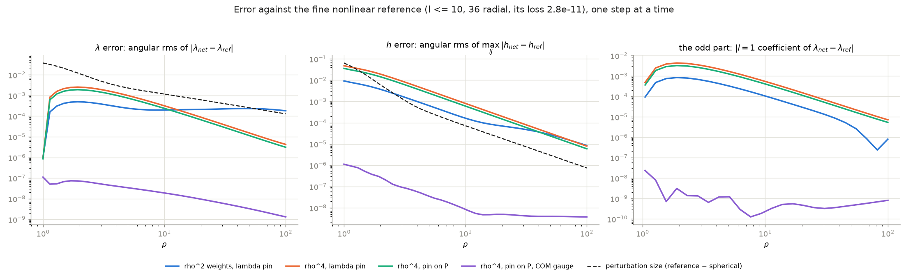

# Report: the pin on P and the centre-of-mass gauge

*2026-10-18.  Stationary problem: static vacuum, harmonic gauge, inner sphere rho = 1 with
lambda = 1/3 - (1/12) P2(cos theta) and a round induced metric, Robin conditions at rho_out = 100.
All runs: the same 2285-parameter axisymmetric network.  Numbers: `scripts/report_metrics.py`
(cached in `plots/report_metrics.json`); figure: `scripts/report_figures.py`.*

## Summary

Two corrections to the problem statement, together with the rho^4 weighting, took the error against
the nonlinear reference from ~2e-3 to ~7e-8 near the inner sphere, and from ~2e-5 to ~3e-9 far out:
4-5 orders of magnitude, now 5-6 orders below the size of the quadrupole perturbation itself.

1. **The pin moved from lambda to P.**  The averaged outer pin <(rho d_rho + 1)(lambda - 1)> = 0 is
   violated by the exact solution: lambda = 1 - 2M/rho + 2M^2/rho^2 - ... and the operator leaves the
   2M^2/rho^2 term, -6.6e-5 at rho = 100.  That costs 4.3e-7 in the loss, which was 98% of the loss
   of every rho^4 run, so no optimiser could go below it.  On the Geroch-Hansen potential
   P = (1 - lambda^2)/(4 lambda), whose monopole has no rho^-2 term, the same pin costs 1.5e-11.
2. **The centre-of-mass (COM) gauge.**  Harmonic gauge leaves one coordinate freedom the boundary data
   do not fix: x -> x + xi with Delta_h xi = 0, xi = 0 on the inner sphere and xi -> a at infinity, a
   translation of the asymptotic chart.  The networks drifted into it (centre of mass a ~ -0.04 although
   the data are symmetric), and compared point by point with the reference it looks like an odd-parity
   error.  The condition D = 0 removes it, where

       D^i = oint ( x^i dU/dn - U dx^i/dn ) dA_h ,   U = (1/2) ln lambda,

   is the same on every sphere (Green's identity: U and x^i are both h-harmonic) and equals 4 pi M a.
   Imposed on six spheres, rho = 1 ... 100.  It is a gauge choice, available for any data.

## The four steps

| step | run | weights | outer pin | COM | optimiser | final loss (own objective) | pin share of the loss | d_z = D_z/4pi |
|---|---|---|---|---|---|---|---|---|
| 0 | `ib16k_ssbroyden` | rho^2 | lambda | -- | SSBroyden | 1.74e-8 | 2.4% | -6.6e-3 |
| 1 | `m4_ssb_rho4` | rho^4 | lambda | -- | SSBroyden | 4.50e-7 | **97.9%** | -3.4e-2 |
| 2 | `m5_ssb_norsmp` | rho^4 | **P** | -- | SSBroyden | 2.13e-9 | 3.1% | -2.6e-2 |
| 3 | `m7_dsg_com` | rho^4 | P | **yes** | DSGNAR | **1.16e-10** | 25% | **~1e-8** |

Losses under different weightings (rho^2 vs rho^4) are not comparable; the errors below are.  d_z is
the same on every sphere (rho = 1, 2, 10, 100) in each run, as the theory says, except step 0, where
it drifts at rho = 100 (-1.7e-3).  Step 3 uses DSGNAR because SSBroyden could not start from step 2
under the new term (see REPORT_OPTIMISERS.md); the SSBroyden run from step 3 is pending.

## Error against the fine nonlinear reference

The reference: spectral, l = 0..10, 36 radial Chebyshev modes, rho^4 weights, pin on P; loss 2.8e-11,
far field rho^-3.00.  Angular rms of the difference, by region:

| | lambda, rho 1-3 | 3-10 | 10-30 | 30-100 | h, rho 1-3 | 3-10 | 10-30 | 30-100 |
|---|---|---|---|---|---|---|---|---|
| *perturbation size* | *2.0e-2* | *2.5e-3* | *7.6e-4* | *2.6e-4* | *2.2e-2* | *4.5e-4* | *3.1e-5* | *3.5e-6* |
| 0: rho^2, lambda pin | 4.1e-4 | 2.5e-4 | 2.1e-4 | 2.2e-4 | 5.1e-3 | 7.5e-4 | 9.2e-5 | 2.9e-5 |
| 1: rho^4, lambda pin | 2.1e-3 | 1.0e-3 | 1.6e-4 | 1.9e-5 | 2.6e-2 | 3.9e-3 | 3.7e-4 | 3.9e-5 |
| 2: rho^4, pin on P | 1.6e-3 | 7.8e-4 | 1.2e-4 | 1.4e-5 | 2.0e-2 | 2.9e-3 | 2.8e-4 | 2.9e-5 |
| **3: + COM gauge** | **6.7e-8** | **3.4e-8** | **1.2e-8** | **3.4e-9** | **4.8e-7** | **3.7e-8** | **5.0e-9** | **4.0e-9** |

## The error was the gauge offset

Without the COM condition the error near the inner sphere is proportional to the run's centre-of-mass
offset d, with the same constant in every run -- whatever the weighting, pin or optimiser:

| run (no COM) | d_z | lambda error, rho 1-3 | ratio |
|---|---|---|---|
| `ib16k_ssbroyden` (rho^2, SSBroyden) | -6.6e-3 | 4.1e-4 | 0.062 |
| `m2_dsg_s2000_t075` (rho^2, DSGNAR) | +1.4e-2 | 8.6e-4 | 0.061 |
| `m5_ssb_norsmp` (rho^4, P pin) | -2.6e-2 | 1.6e-3 | 0.062 |
| `m4_ssb_rho4` (rho^4, lambda pin) | -3.4e-2 | 2.1e-3 | 0.062 |
| `m3_dsg_s2000_rho4` (rho^4, DSGNAR) | -3.5e-2 | 2.1e-3 | 0.060 |

The difference network - reference is odd (l = 1 and 3 Legendre modes of lambda; the right panel of
the figure), which the z -> -z symmetry of the data forbids; far out it is a translation (the l = 1
difference drops 8-23x once the reference is shifted by a = d/M); every loss term is exactly symmetric
under z -> -z, so nothing forced it -- the objective simply did not see it (COM_GAUGE.md 4b).

## Residuals and data (dimensionless: rho^2 Ricci, rho^2 lambda equation)

| | Ricci 1-3 | 3-10 | 10-30 | 30-100 | lambda eq 1-3 | 3-10 | 10-30 | 30-100 | inner lambda | inner h |
|---|---|---|---|---|---|---|---|---|---|---|
| 0 | 6.8e-5 | 1.9e-5 | 1.5e-5 | 1.2e-5 | 5.6e-5 | 2.7e-5 | 4.8e-5 | 1.8e-4 | 9.8e-7 | 1.2e-6 |
| 1 | 4.3e-5 | 1.3e-6 | 6.2e-8 | 4.7e-9 | 1.9e-5 | 8.1e-7 | 4.7e-8 | 4.3e-9 | 9.0e-7 | 8.9e-7 |
| 2 | 3.9e-5 | 9.5e-7 | 5.4e-8 | 4.3e-9 | 1.4e-5 | 6.6e-7 | 3.4e-8 | 3.5e-9 | 8.8e-7 | 6.9e-7 |
| **3** | **3.0e-6** | **4.9e-8** | **5.1e-9** | **9.7e-10** | **3.3e-6** | **6.3e-8** | **6.4e-9** | **7.2e-10** | **1.1e-7** | **7.4e-8** |

The rho^4 weighting (step 1) already fixed the far field (lambda equation 1.8e-4 -> 4e-9 beyond
rho = 30); the COM gauge (step 3) brought everything else down by ~10x more, and with it the loss.

## Caveats

* Step 3 differs from step 2 also in the optimiser (DSGNAR with restart cycles, as SSBroyden could not
  start).  The SSBroyden run from step 3 (`m8_ssb_com`) and DSGNAR's continuation are pending.
* At the 1e-8 level part of the remaining difference may be the reference's own (its loss is
  2.8e-11, the network's 1.2e-10).
* The symmetric data make the odd part easy to see; the COM condition itself does not use the
  symmetry.  The first asymmetric test (S1 = 0.05) is pending (`m8_s1_dsg`, DSGNAR.md 9.2).

Details and the run-by-run history: DSGNAR.md 9.2, COM_GAUGE.md 4b, PERTURBATION.md 5.2b.
