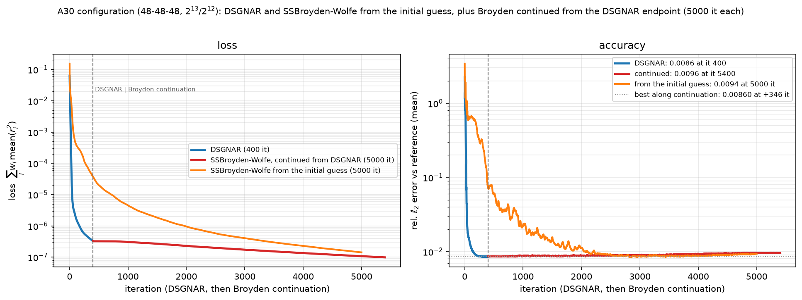
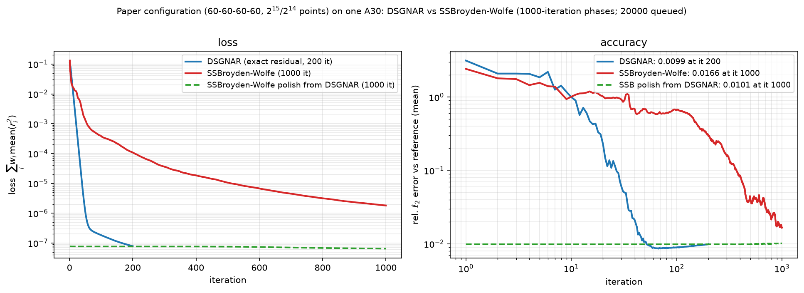

# Report: the lid-driven cavity with the paper's optimiser on an A30 (Mendieta)

*Status: the paper configuration trains from scratch on **one A30 in 14 minutes** and reaches
rel L2 ≈ 1.2e-2; the same configuration on Clementina's Intel tile either stalls or needs hours.
This report records the results, the figures, and — in detail — everything that had to be fixed
to get there: the memory limits, the flags, the early stalls, and the infrastructure mistakes.*

---

## 1. What was run, and the two configurations

Two problem configurations are used throughout. Naming matters: only the first one is "the
paper configuration".

| | **paper configuration** | **A30 (reduced) configuration** |
|---|---|---|
| network | SIREN 60-60-60-60, **11 347** parameters | SIREN 48-48-48, 4 998 parameters |
| collocation points | 2^15 PDE / 2^14 BC | 2^13 / 2^12 |
| parameter sketch `s` | 4000 | 1665 (= d/3) |
| batch / probe batch | 2^12 (paper) — we used 1024 | 1024 / 128 |
| DSGNAR budget | 200 steps, radius floor 1e-8 | 400 steps, radius floor 1e-14 |
| SSBroyden-Wolfe | 1000 + 1000 iterations | 10 000 + 10 000 iterations |
| reference | `ldc/reference_gen/ldc_reference.npz`, Re = 100, 16 641 eval points | same |

Hardware used:

* **Clementina XXI** — Intel Data Center GPU Max 1550, 128 GB/card (48 GiB device cap),
  JAX 0.11.2 + `jax[oneapi]` (experimental SYCL backend).
* **Mendieta** (UNC, Slurm) — 19 nodes × **2 × NVIDIA A30**, 24 576 MiB per card, 64 GB host RAM;
  partitions `multi` (2-day limit) and `short` (1 h), account `ifeg`.
* The hub's A30 is a *shared 19.3 GiB HAMi slice*; that is where the reduced configuration came
  from, and it is not the same thing as a whole card.

---

## 2. Results

### 2.1 Paper configuration

| run (one A30 unless noted) | steps | rel L2 mean | u | v | p | wall |
|---|---|---|---|---|---|---|
| **paper trainer `pinn.train64`, from scratch** (job 1184086) | 10 f32 + 103 f64 (stopped on the radius floor) | **0.011845** | 0.001531 | 0.003008 | 0.030996 | **13.3 min** |
| paper trainer, warm-started from the trained set (1184058) | 27 f64 | 0.009223 | 0.001345 | 0.002575 | 0.023750 | 4.8 min |
| exact-residual driver, DSGNAR 200 steps (1181874) | 200 | **0.009863** (loss 7.80e-08) | 0.001328 | 0.002648 | 0.025612 | 37.7 min |
| **Intel tile** (1549653, exact residual) | 125 of 200 then stalled | 0.5366 | — | — | — | 6 h |
| Intel tile, older count-sketch trainer (1548877) | — | 0.06372 | — | — | — | ~2 h |

The paper trainer's own summary records only rel L2 (the run stops on its radius threshold, 1e-8),
not the loss; the driver records both.

The loader re-scores the saved networks slightly differently for `p` from the trainer's own
metric (the trainer masks mean-shifted pressure with |p_shift| < 0.4; the loader does not):
fresh → `{"u": 0.001531, "v": 0.003008, "p": 0.036671, "mean": 0.013737}`;
warm → `{"u": 0.001345, "v": 0.002575, "p": 0.025596, "mean": 0.009839}`.

### 2.2 A30 (reduced) configuration

| run (one A30) | loss | rel L2 mean | wall |
|---|---|---|---|
| DSGNAR exact residual, 400 steps (1549619, Intel A30) | 3.12e-07 | **0.008634** | 52 min |
| SSBroyden-Wolfe from x0, 10 000 iterations | 3.64e-08 | 0.011402 | — |
| SSBroyden-Wolfe polish from the DSGNAR end, 10 000 it | — | 0.011087 | 541.8 s (polish) |
| hub A30 reference (count sketch) | 1.84e-07 | 0.009266 | 203 s |

Saved and re-verified artifacts:

* `ldc/params/mendieta_a30_paper_trainer_60x4_fresh.{npy,json}` — paper config, from scratch
* `ldc/params/mendieta_a30_paper_trainer_60x4_warm.{npy,json}` — paper config, warm start
* `ldc/params/mendieta_a30_paper_60x4_exact.{npy,json}` — paper config, exact-residual driver
* `ldc/params/intel_a30_exact_48x48x48.{npy,json}` — A30 config, exact residual (0.008634)
* summaries/histories/results under `clementina/results/`

Reload any of them with:

```bash
python clementina/ldc_params.py --params ldc/params/<file>.npy --network ldc/params/<file>.json
```

---

## 3. The figures

### 3.1 Optimiser comparison (A30 configuration, one A30)



* **blue** — DSGNAR (exact residual, 400 iterations): rel L2 **0.0086**.
* **orange** — SSBroyden-Wolfe **from the initial guess**, first 5 000 iterations (of 10 000):
  its accuracy minimum is **0.00839 at iteration ≈ 2 832**, then it degrades; at 5 000 it is
  0.0094 and at 10 000 it is 0.0114.
* **red** — SSBroyden-Wolfe **continued from the DSGNAR endpoint**, first 5 000 iterations:
  loss 3.27e-7 → 9.87e-8, but rel L2 0.0086 → 0.0096 — it lowers the loss ~3× without improving
  the field.

The lesson that keeps repeating: **the paper loss is not the accuracy metric.** Broyden reaches
a lower loss than DSGNAR while being less accurate, and continuing it after DSGNAR does not buy
accuracy. That is also why the extra 20 000-iteration paper-configuration Broyden run was
cancelled: its optimum lies before ~3 000 iterations.

### 3.2 Paper configuration



DSGNAR (200 it) vs the 1 000-iteration Broyden phases available at that configuration
(from-x0 0.0166; polish from DSGNAR 0.0101).

Other figures in the repository:
`results/ldc_a30_optimizers_loss_accuracy_5k.png` (A30 config, both Broyden runs cut at 5 000),
`results/ldc_a30_optimizers_loss_accuracy.png` (uncut 10 000), `../ldc/figures/fields_u.png`, `../ldc/figures/fields_p.png` (fields against the reference).

---

## 4. What had to be fixed to be able to run (the memory story)

This is the part worth remembering. There were **four independent memory problems**, and only
the last two were the hardware.

### 4.1 The card is 24 GiB; the "17.7 GiB" we printed was JAX, not the card

`ldc_run.py` printed `device limit` from
`jax.devices()[0].memory_stats()['bytes_limit']`. With `XLA_PYTHON_CLIENT_PREALLOCATE=false`
and JAX's **default `XLA_PYTHON_CLIENT_MEM_FRACTION=0.75`**, that is 0.75 × 24 GiB ≈ 18 GiB,
while `nvidia-smi` in the same job reports **24 576 MiB**. The lesson: *report both*, never
confuse an allocator budget with hardware. All Mendieta jobs now set

```bash
export XLA_PYTHON_CLIENT_PREALLOCATE=false
export XLA_PYTHON_CLIENT_MEM_FRACTION=0.9      # ~21.2 GiB of the 24 GiB card
```

and the preflight prints nvidia-smi's total, the fraction, the resulting `bytes_limit`, and the
Jacobian estimate with 4× headroom.

### 4.2 The real "27.00 GiB" OOM was the XLA **autotuner's workspace**, not the evaluation

Every failure read the same:

```
RESOURCE_EXHAUSTED: Out of memory while trying to allocate 27.00GiB with allocator GPU_0_bfc
... executable_name='jit__eval_model_jit'  (or jit__eval_model_batch_jit, jit_concatenate)
```

and the HLO pass warned `Can't reduce memory use below 20.17GiB ... only reduced to 26.88GiB`.
That looked like the evaluation of the 16 641-point reference grid, so I chunked it — and the
27 GiB simply moved to the next op. Measuring the evaluation graph on the GPU in isolation gave
**0.015 GiB**, and with `--xla_gpu_autotune_level=0` it is 0.015 GiB in the trainer too. The
27 GiB was XLA's autotuner choosing a kernel whose workspace is 27 GiB.

The subtlety: `ldc_paper_run.py` *does* set that flag, but with `os.environ.setdefault` **after
`jax` has been imported**, so XLA has already parsed its flags. Fix: export it in the shell,
before Python starts.

```bash
export XLA_FLAGS="--xla_gpu_autotune_level=0"
```

This single line is why the paper trainer ran for hours on Clementina's 48 GiB card (27 GiB
fits there) and failed instantly on a 24 GiB A30.

### 4.3 The training step at the paper batch does not fit 21 GiB either

With autotuning off, the next failure was a genuine memory limit: the DSGNAR step builds a dense
Jacobian per macro-batch, `batch × 3 × n_params × 8` bytes plus XLA temporaries.

| batch | dense Jacobian (11 347 params) | fits 21.2 GiB? |
|---|---|---|
| 2^12 = 4096 (paper) | 1.04 GiB (+ temporaries) | **no** — the step needs > 21 GiB |
| 1024 | 0.26 GiB | **yes** |

`batch_size` only chunks the Jacobian accumulation; it does not change the algorithm (in the
exact-residual mode it is mathematically irrelevant, and in the count-sketch mode it only changes
the random sketch draws). The paper trainer gained a `--batch` flag and the runs use `1024`.

### 4.4 Warm start: resuming from a trained set instead of restarting

The vendored trainer has **no mid-run checkpoint**, and the `short` partition only allows 1 h, so
retrying a timed-out run from scratch is hopeless. Fix: `RunConfig.initial_params` (flat `.npy`)
is honoured in `trainer64.train()` — the network structure comes from `config.network`, only the
trainable leaves are replaced — and `ldc_paper_run.py --warm-start PATH` exposes it. The log
line `[warm] starting from trained parameters (11347 values)` confirms it. This turned the
paper-configuration rerun into a 5 m 45 s job and is what makes 1 h windows practical.

### 4.5 (Defensive) chunked, device-parallel evaluation

Because the 27 GiB was first mis-attributed to the grid evaluation, both trainers now support
`PINN_EVAL_CHUNK` (points per compiled evaluation) and `PINN_EVAL_DEVICE_PARALLEL` (dispatch
successive chunks to successive local devices, with **host-side** concatenation — `jnp.concatenate`
across devices hits the same pathological lowering). The chunked result is **bit-identical** on
CPU (`max|diff| 0`). With the autotune flag fixed these are not needed (the evaluation is
0.015 GiB and a 2-device split saved 0.54 s → 0.51 s), but they are available.

---

## 5. What happened at the beginning: the stalls and the failures

### 5.1 The DSGNAR stall on Clementina (Intel) — three separate causes

1. **Float32 pre-pass overflow.** DSGNAR's first step has `rho = NaN` and is rejected, the radius
   collapses, and the run reaches only rel L2 0.57. Diagnostics (staged NaN census, replay with
   the exact key chain) showed the float32 *probe evaluation* produces residual-squared ~1e12 or
   NaN — the lifted probe steps overflow in single precision on this backend. The Jacobian,
   sketch, SVD and secular solve were clean in both dtypes. Fix: start in float64
   (`--float32-steps 0`).
2. **The count-sketch leaves a rank-deficient system.** At the A30 configuration only 258 of
   1665 singular values were above 1e-12·max (down to 1e-17), so the trust-region step
   amplifies near-null directions and is platform-sensitive: identical inputs, `S` and λ agreeing
   to 1e-15, yet the realised probe losses differed 3× between platforms. Run-to-run the Intel
   backend was deterministic and `--xla_gpu_deterministic_ops` changed nothing, so this is
   arithmetic, not scheduling.
3. **The residual sketch itself is the noise floor.** The other agent's analysis
   (`SBH/06fac11`, shared from the parallel workstream) showed DSGNAR's step direction is
   `JᵀCᵀCr`, whose sketch-noise term `Jᵀ(CᵀC−I)r ~ |J||r|/√s` stops shrinking when the true
   gradient does: near the floor the step becomes near-random (uphill in 8/20 draws; never with
   an exact residual) and the radius collapses. Their fix — **exact residual rows**, accumulating
   `G=(JΩS)ᵀ(JΩS)`, `b=(JΩS)ᵀr` over every row — accepted 30/0 steps vs 2/13 from a stall point.

That fix was ported into the vendored paper optimiser behind a default-off
`exact_residual=True` flag. Three bugs had to be fixed in the port, each found by a cheap local
reproducer:

* the exact Gram matrix has **exact zeros** in the null directions (the count sketch leaves
  ~1e-17 noise); the secular solver starts at λ = 0, so `g/(S²+λ)` was 0/0 → every step NaN.
  Floor `S` after truncating `g`.
* `jnp.linalg.eigh` on the 1665² Gram matrix in float64 crashed the SYCL compiler
  (`SPV_EXT_long_vector`); the SVD of the same matrix compiles. For symmetric PSD `G`,
  `S = sqrt(σ)`, `Vt = Vᵀ`, `g = Vᵀb` is identical.
* unrolling 48 macro-batches of `jacrev` in Python produced a graph whose temporaries starved
  the FFT scratch allocator; `jax.lax.scan` over the macro-batches (as the count-sketch path
  already did) fixed it.

Result on the Intel tile: A30 configuration rel L2 **0.008634** in 52 min (best result anywhere),
but the *paper configuration* still stalled at rel L2 0.5366 after 125 of 200 steps in 6 h.

### 5.2 The first Mendieta attempts (all cheap, all instructive)

| job | what happened | fix |
|---|---|---|
| 1181994 | OOM 27 GiB in the trainer at batch 2^12 | (mis-attributed to the grid evaluation first) |
| 1181747/48 | died in 1 s: `FATAL: no interpreter with jax` | a git **worktree has no untracked `.venv`**; pin `PY` to the CUDA interpreter before `find_python` |
| 1183265 | died in 12 s: `SyntaxError` in the new preflight (f-string split across `subprocess.run`) | fixed the f-string |
| 1183266 | preflight abort: "wants 2 devices, sees 1" | preflight now accepts one GPU (the chunked eval is sequential then) |
| 1184026/28 | OOM 27 GiB again | this time identified as the **autotuner workspace**, and the training step's batch |
| 1184058 | **completed**, 5 m 45 s, warm start | `XLA_FLAGS` before python + `--batch 1024` + warm start |
| 1184086 | **completed**, 14 m 11 s, from scratch | same settings, no warm start |

Other process lessons: `pkill -f <script>` inside an `ssh` command matches the ssh shell itself
and kills the session; a `setsid nohup` watcher launched from a session does not always survive,
so notifications are now pushed from the **login node** (compute nodes have no outbound
internet — the in-job `curl` to ntfy silently failed); and Slurm `--test-only`/`squeue --start`
is the way to choose between `short` (1 h, schedules quickly) and `multi` (2 days, weeks of
queue).

---

## 6. Reproduce it

Mendieta, one A30, paper configuration from scratch (≈14 min):

```bash
# once: a checkout of origin/main in a separate worktree (the other agent's tree untouched)
git -C ~/Julia/PINN worktree add ~/ldc_paper_run origin/main
cd ~/ldc_paper_run

# environment: the two lines that matter
export XLA_FLAGS="--xla_gpu_autotune_level=0"        # BEFORE python (27 GiB autotuner workspace)
export XLA_PYTHON_CLIENT_MEM_FRACTION=0.9             # the card is 24 GiB, not 75% of 24 GiB
export LDC_BATCH=1024                                # the training step at 2^12 does not fit
export PINN_EVAL_CHUNK=512                            # defensive; not needed once autotune is off

sbatch -p short -A ifeg --gres=gpu:1 -c 8 --mem=32G -t 01:00:00 \
       clementina/22_mendieta_paper_trainer_parallel.sbatch
```

Warm start instead (≈5 min): add `export LDC_WARM_START=ldc/params/mendieta_a30_paper_60x4_exact.npy`
and `export LDC_F32=0`. To retry on the 1 h partition until success, the login node runs
`~/ldc_paper_run/short_retry_loop.sh <jobid-or-empty>`: it resubmits with the same environment,
waits for each attempt and pushes its state to ntfy (compute nodes have no outbound internet, so
the push must come from the login node).

DSGNAR on Clementina (Intel), A30 configuration (≈52 min):

```bash
sbatch -p gpunode -t 01:30:00 clementina/17_gpu_a30_exact.sbatch
# equivalently: python clementina/ldc_run.py --mode a30 --exact-residual --float32-steps 0
```

The variants: `16_gpu_replay_exact.sbatch` (8-step smoke of the fix),
`11_diag.sbatch` (NaN census + one real step + key-chain replay), `20a/20b` (paper trainer /
driver on Mendieta), `22_..._parallel.sbatch` (trainer with the parallel evaluation).

---

## 7. Checklist before submitting another GPU job

1. Interpreter: `jax`, `equinox`, `jaxtyping`, `optax`, `scipy` all import — in the *runtime*
   tree (a worktree has no untracked venv).
2. Card: `nvidia-smi` total vs `jax.devices()[0].memory_stats()['bytes_limit']` and the
   `MEM_FRACTION` — never compare a budget with hardware.
3. `XLA_FLAGS=--xla_gpu_autotune_level=0` exported **in the shell**, before Python.
4. Memory arithmetic: dense Jacobian `batch × 3 × n_params × 8` (×4 headroom) and the
   autotuner's workspace; reduce `--batch` if needed (it only chunks).
5. Start state and checkpointing: warm start if the budget is short, periodic save if the run is
   long (the vendored trainer has none).
6. Partition: `--test-only` / `squeue --start` first; `short` schedules in minutes, `multi` may
   wait days.
7. Notifications: push from the login node, not from the compute node.

---

## 8. Open items

* The paper configuration's **exact-residual driver** result (0.009863) and the **paper trainer**
  results (from scratch 0.011845, warm 0.009223) all fit one A30; the Intel tile remains unusable
  for DSGNAR at this configuration (it stalls), although SSBroyden is unaffected there.
* The 20 000-iteration paper-configuration Broyden run was cancelled: the A30-configuration data
  shows Broyden's accuracy optimum is before ~3 000 iterations.
* No job of ours is queued or running; all figures, histories and parameters are committed.
